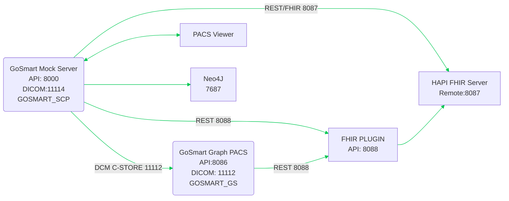
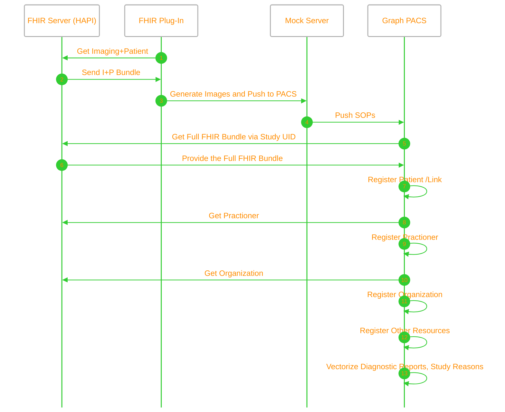

# GoSmart DICOM Graph Server (`gosmart-dicom-py-graph-server`)

A high-performance DICOM Knowledge Graph backend server powered by **Python 3.14**, **FastAPI**, **Pydantic**, **Neo4j**, **pydicom**, **pynetdicom**, and **Pykka**.


---

## 🚀 Features

- **FastAPI & Pydantic**: Async REST API endpoints with automated OpenAPI schemas (`/docs`), strong typing, and validation.
- **Neo4j Knowledge Graph**: Models the DICOM hierarchy `(:Patient)-[:HAS_STUDY]->(:Study)-[:HAS_SERIES]->(:Series)-[:HAS_INSTANCE]->(:Instance)` with uniqueness constraints and indexed lookup.
- **Auditable & Immutable Entity System**: All nodes and relationships derive from `Auditable` featuring deterministic UUIDv5 IDs derived from canonical JSON property subsets, `test_id` telemetry isolation, UTC Cypher timestamps (`CreatedAt`, `ActedAt`, `ExpiresAt`), and immutable action logs (`Action`, `ActedBy`).
- **Reserved `NOT_` Relationship Semantics**: Non-destructive relationship soft-deletion executing atomic property-cloning swaps to `NOT_<rel_type>` within managed Neo4j write transactions.
- **pydicom & pynetdicom**: DICOM header parsing, file persistence, mock dataset generation, and network operations (C-ECHO SCU, C-STORE SCP / SCU, Verification).
- **DICOMweb Standard**: RESTful DICOMweb services (STOW-RS, WADO-RS, QIDO-RS) for web-native DICOM interoperability.
- **Pykka Concurrency**: Actor model (`DicomIngestionActor`, `AuditActor`, `StoreSCUActor`) for non-blocking asynchronous DICOM ingestion, audit logging, and outbound Store SCU transfers.
- **Dynamic DICOM SCP Lifecycle**: Runtime-configurable SCP instances with presentation context enforcement, service class negotiation, and graceful draining of active associations.
- **Authentication & Authorization**: JWT access/refresh tokens, API key authentication (`gs_live_` prefix), Google OAuth2 / OIDC federated login, scoped RBAC with DICOM-level authorization, and Argon2 password hashing.
- **Model Context Protocol (MCP)**: Built-in MCP server with SSE, StreamableHTTP, and STDIO transports for AI agent integration (Cursor, Cline, AntiGravity).
- **Vector Embedding Computation Service**: Unified text embedding generation (`VectorService`) powered by **Genkit** (`genkit-ollama` and `genkit-google-genai`) supporting both local/network Ollama models (e.g., `nomic-embed-text:latest`) and Google Vertex AI embedding models with L2 vector normalization.
- **Audit Trail**: Structured audit logging with configurable retention, Neo4j persistence, and background `AuditActor` for non-blocking audit writes.
- **Docker & Docker Compose**: Multi-stage Dockerfile with full-stack `docker compose` orchestration (Graph Server + Neo4j), health checks, named volumes, and unprivileged runtime user.
- **CLI Management Tool**: Typer-based CLI (`src/cli.py` / `gosmart-gs`) with `start`, `health`, `echo`, `send`, `mcp`, and `admin` commands for server operation and administration.
- **CI/CD Pipeline**: GitHub Actions workflow with Ruff linting, pip-audit vulnerability scanning, CycloneDX SBOM generation, multi-platform unit tests, and Docker build verification.
- **UV & Python 3.14**: Managed with Astral `uv` on Python 3.14.
- **Interactive Exploration Notebook**: Ready-to-run Jupyter notebook exploring all library functions.

---

## 📁 Project Structure

```text
gosmart-dicom-py-graph-server/
├── src/                         # Python application source code
│   ├── actor/                   # Pykka Actor system
│   │   ├── __init__.py
│   │   ├── audit_actor.py       # Background audit logging actor
│   │   ├── dicom_actor.py       # DICOM ingestion & processing actor
│   │   ├── fhir_actor.py        # Background FHIR fetching & graph registration actor
│   │   └── store_scu_actor.py   # Outbound C-STORE SCU transfer actor
│   ├── api/                     # FastAPI routes & endpoints
│   │   ├── __init__.py
│   │   └── v1/
│   │       ├── endpoints/
│   │       │   ├── auth.py      # Login, token refresh, API key management, OAuth2
│   │       │   ├── dicom.py     # Ingestion, mock generator, and C-ECHO endpoints
│   │       │   ├── dicomweb.py  # DICOMweb RESTful services (STOW-RS, WADO-RS, QIDO-RS)
│   │       │   ├── graph.py     # Graph traversal and Cypher query endpoints
│   │       │   ├── health.py    # Health status (Neo4j, Pykka, Storage)
│   │       │   └── system.py    # System metadata, DICOM configurations, bootstrap
│   │       └── router.py        # Aggregated v1 API router
│   ├── cli/                     # Administrative CLI subcommands
│   │   ├── __init__.py
│   │   └── admin.py             # Admin bootstrap & API key generation commands
│   ├── core/                    # Application settings & logging
│   │   ├── __init__.py
│   │   ├── auth_dependency.py   # FastAPI dependency for JWT / API key authentication
│   │   ├── config.py            # Pydantic Settings with GOSMART_GS_ prefix
│   │   ├── logging.py           # Structured logging (structlog) with rotation
│   │   └── security.py          # JWT signing, Argon2 hashing, API key utilities
│   ├── db/                      # Database connections
│   │   ├── __init__.py
│   │   ├── fhir_schema.cypher   # FHIR R4B Neo4j schema constraints & indexes
│   │   └── neo4j.py             # Neo4j async client, pooling, schema constraints
│   ├── model/                   # Pydantic domain models
│   │   ├── __init__.py
│   │   ├── audit.py             # Audit log and audit trail models
│   │   ├── auth.py              # JWT token, API key, OAuth request/response models
│   │   ├── dicom.py             # Patient, Study, Series, Instance models
│   │   ├── fhir/                # FHIR R4B graph node and relationship models
│   │   ├── graph.py             # Cypher and graph schema models
│   │   ├── health.py            # Health response models
│   │   ├── media.py             # StorageScheme, ParsedStorageUri, MediaMetadata
│   │   └── system.py            # System, DICOMConfiguration, User, Group models
│   ├── service/                 # Business logic services
│   │   ├── __init__.py
│   │   ├── dicom_service.py     # pydicom parsing, mock generation, storage save
│   │   ├── dicomweb_service.py  # DICOMweb STOW-RS, WADO-RS, QIDO-RS implementations
│   │   ├── embedding_service.py # Genkit vector embedding computation (Ollama & Vertex AI)
│   │   ├── fhir_service.py      # FHIR R4B batch fetching and Neo4j graph upsert
│   │   ├── graph_service.py     # Cypher queries for DICOM & FHIR hierarchy
│   │   ├── group_service.py     # Organization and group management
│   │   ├── mcp_service.py       # MCP server (SSE, StreamableHTTP, STDIO transports)
│   │   ├── media_service.py     # Storage-agnostic async media (Local, UNC, GCS, S3, Azure)
│   │   ├── pynetdicom_service.py# Dynamic SCP lifecycle, C-STORE/C-ECHO, network AE
│   │   ├── system_service.py    # System bootstrap, DICOM configuration management
│   │   └── user_service.py      # User CRUD, admin bootstrapping, password management
│   ├── cli.py                   # Typer CLI entrypoint (start, health, echo, send, mcp)
│   └── main.py                  # FastAPI application factory & Uvicorn entrypoint
├── devop-scripts/               # DevOps & data cleanup CLI utilities
├── neo4j/                       # Standalone Neo4j Docker Compose for development
│   ├── docker-compose.yaml      # Neo4j-only compose (for local dev/testing)
│   └── README.md                # Neo4j Docker setup guide
├── notebooks/                   # Exploration and interactive experiments
│   └── exploration.ipynb        # Interactive notebook for pydicom, neo4j, pykka, etc.
├── start.sh                     # Shell script shortcut for local development launch
├── pyproject.toml               # Project metadata, dependencies (uv/hatchling)
├── uv.lock                      # Locked dependency versions
├── Dockerfile                   # Multi-stage Docker build (Python 3.14 + uv)
├── docker-compose.yml           # Full-stack compose (Graph Server + Neo4j)
├── .env.example                 # Environment variable template
├── .dockerignore                # Docker build context exclusions
├── .github/workflows/ci.yml     # CI pipeline (lint, audit, SBOM, tests, Docker build)
└── tests/                       # Test suite
    ├── assets/mr/               # 10 MR DICOM validation test assets
    ├── rest-client/             # VS Code REST Client scripts (.http files)
    ├── conftest.py
    ├── test_actor.py
    ├── test_admin_bootstrap.py
    ├── test_api.py
    ├── test_audit.py
    ├── test_auth_api.py
    ├── test_auth_graph_models.py
    ├── test_config.py
    ├── test_dicom_store_scp.py
    ├── test_dicomweb.py
    ├── test_dicomweb_audit.py
    ├── test_dimse_qr.py
    ├── test_endpoint_security.py
    ├── test_fhir_models.py
    ├── test_fhir_service.py
    ├── test_graph_service.py
    ├── test_group_service.py
    ├── test_live_mdicom_move.py
    ├── test_logging.py
    ├── test_mcp.py
    ├── test_mcp_security.py
    ├── test_media_service.py
    ├── test_neo4j.py
    ├── test_rebac_dicom_scope.py
    ├── test_rebac_penetration.py
    ├── test_scp_lifecycle.py
    ├── test_scp_local_address.py
    ├── test_security_core.py
    ├── test_store_scu_actor.py
    ├── test_system_api.py
    ├── test_system_mcp.py
    ├── test_system_service.py
    ├── test_transfer_syntax_preservation.py
    ├── test_user_service.py
    └── test_vector_service.py
```

---

## ☁️ Storage Agnostic Media Service (`media_service.py`)

`gosmart-dicom-py-graph-server` includes a unified, storage-agnostic `MediaService` (`src/service/media_service.py`) that abstracts file operations across local storage, Windows network shares, and multi-cloud providers.

### Supported URI Schemes

| Provider / Target | URI Scheme Prefix | Example URI |
| :--- | :--- | :--- |
| **Google Cloud Storage** | `gs://` (or `gcs://`) | `gs://my-dicom-bucket/mr_studies/MR.01.dcm` |
| **Amazon S3** | `s3://` (or `s3a://`) | `s3://my-dicom-bucket/mr_studies/MR.01.dcm` |
| **Azure Blob Storage** | `az://` (or `azure://`, `abfs://`) | `az://dicom-container/mr_studies/MR.01.dcm` |
| **Local File** | `file://` (or absolute path) | `file:///data/storage/MR.01.dcm` |
| **Windows UNC** | Denoted by backslash (`\\` or `\`) | `\\hospital-nas\imaging_share\MR.01.dcm` |

### Cloud Credentials (SDK Standard Labels)

The service automatically resolves credentials from standard environment variables:
- **GCP**: `GOOGLE_APPLICATION_CREDENTIALS` (JSON key file path), `GOOGLE_CLOUD_PROJECT` / `GCP_PROJECT`, `GCS_ENDPOINT_URL` (emulator host)
- **AWS**: `AWS_ACCESS_KEY_ID`, `AWS_SECRET_ACCESS_KEY`, `AWS_SESSION_TOKEN`, `AWS_DEFAULT_REGION` / `AWS_REGION`, `AWS_ENDPOINT_URL`
- **Azure**: `AZURE_STORAGE_CONNECTION_STRING`, `AZURE_STORAGE_ACCOUNT_NAME`, `AZURE_STORAGE_ACCOUNT_KEY`, `AZURE_STORAGE_SAS_TOKEN`

### Asynchronous & Actor Execution

All core operations in `media_service` (`read`, `write`, `exists`, `delete`, `stat`, `list_files`, `copy`, `move`, `read_dicom`, `write_dicom`) are asynchronous (`async def`). For Pykka actors running on worker threads (e.g. `pykka.ThreadingActor`) or synchronous scripts, `run_sync()` and sync method equivalents (`read_sync`, `write_sync`, etc.) are provided without event loop deadlocks.

---

## ⚙️ Environment Variables (`GOSMART_GS_*`)

Configured via environment variables or `.env`:

| Variable | Default Value | Description |
| :--- | :--- | :--- |
| **Database** | | |
| `GOSMART_GS_DB_CONNECTION_URI` | `bolt://localhost:7687` | Neo4j Connection URI |
| `GOSMART_GS_DB_USER` | `neo4j` | Neo4j Username |
| `GOSMART_GS_DB_PASSWORD` | `password` | Neo4j Password |
| `GOSMART_GS_DB_DATABASE` | `neo4j` | Neo4j Database Name |
| `GOSMART_GS_DB_MAX_CONNECTION_POOL_SIZE` | `50` | Neo4j max connection pool size |
| `GOSMART_GS_DB_MAX_CONNECTION_LIFETIME` | `3600` | Neo4j max connection lifetime (seconds) |
| **FHIR** | | |
| `GOSMART_GS_FHIR_BASE_URL` | `` | FHIR URL root. Empty disables FHIR |
| `GOSMART_GS_FHIR_POLL_SEC` | `120` | FHIR polling interval to check for DiagnosticReport |
| `GOSMART_GS_FHIR_ACCESSION_SYSTEM` | `""` | System for the Accession Number |
| `GOSMART_GS_FHIR_PATIENT_ID_SYSTEM` | `"urn:oid:2.16.840.1.113883.4.3.25"` | System for the Patient ID/ MRN |
| **Vector Embedding** | | |
| `GOSMART_GS_VECTOR_EMBED_PROVIDER` | `""` | Vector embedding provider (`ollama` or `vertexai`; empty disables) |
| `GOSMART_GS_VECTOR_EMBED_SERVER_URL` | `""` | Base URL for local/network Ollama server (e.g. `http://10.200.0.103:11434`) |
| `GOSMART_GS_VECTOR_EMBED_MODEL` | `""` | Embedding model name (e.g. `nomic-embed-text:latest` or `gemini-embedding-001`) |
| `GOSMART_GS_VECTOR_EMBED_DIMENSIONS` | *(None)* | Expected / target vector dimensionality (e.g. `768`) |
| `GOSMART_GS_VERTEX_AI_API_KEY` | *(None)* | API key for Google Vertex AI (Express Mode) / Gemini API (`VERTEX_AI_API_KEY`, `GOOGLE_API_KEY`, or `GEMINI_API_KEY`) |
| `GOSMART_GS_VERTEX_AI_LOCATION` | `us-central1` | Google Cloud region for Vertex AI embeddings |
| **Storage** | | |
| `GOSMART_GS_STORAGE_ROOT_URI` | `file:///tmp/gosmart_dicom_storage` | Storage root URI (file://, gs://, s3://, az://, \\\\unc\\share) |
| **Server** | | |
| `GOSMART_GS_HOST` | `0.0.0.0` | FastAPI host binding |
| `GOSMART_GS_PORT` | `8086` | FastAPI HTTP port |
| `GOSMART_GS_RELOAD` | `true` | Uvicorn auto-reload |
| **Logging** | | |
| `GOSMART_GS_LOG_LEVEL` | `INFO` | Server logging level (DEBUG, INFO, WARNING, ERROR, CRITICAL) |
| `GOSMART_GS_LOG_FORMAT` | `json` | Console log format (`json` or `console`) |
| `GOSMART_GS_LOG_DIR` | `./logs` | Directory for rotating log files |
| `GOSMART_GS_LOG_FILE` | `gosmart_gs.log` | Base name for log file |
| `GOSMART_GS_LOG_ROTATION_DAYS` | `7` | Auto-rotate log files every N days |
| `GOSMART_GS_LOG_BACKUP_COUNT` | `8` | Number of rotated backup files to keep |
| `GOSMART_GS_LOG_TO_FILE` | `true` | Enable rotating file logging |
| **DICOM Network** | | |
| `GOSMART_GS_DICOM_AE_TITLE` | `GOSMART_GS` | Local DICOM Application Entity Title |
| `GOSMART_GS_DICOM_SCP_PORT` | `11112` | DICOM C-STORE / C-ECHO SCP Port |
| `GOSMART_GS_DICOM_MAX_PDU` | `16382` | Maximum PDU length in bytes |
| **Authentication & Security** | | |
| `GOSMART_GS_JWT_SECRET_KEY` | *(Secret)* | Secret key for signing and verifying JWT tokens |
| `GOSMART_GS_JWT_ALGORITHM` | `HS256` | JWT signing algorithm |
| `GOSMART_GS_JWT_ACCESS_TOKEN_EXPIRE_MINUTES` | `60` | Access token expiration in minutes |
| `GOSMART_GS_JWT_REFRESH_TOKEN_EXPIRE_DAYS` | `30` | Refresh token expiration in days |
| `GOSMART_GS_API_KEY_PREFIX` | `gs_live_` | Standard prefix for generated API keys |
| `GOSMART_GS_GOOGLE_OAUTH_CLIENT_ID` | *(None)* | Google OAuth2 / OIDC Client ID for federated login |
| `GOSMART_GS_GOOGLE_OAUTH_CLIENT_SECRET` | *(None)* | Google OAuth2 Client Secret |
| **Admin Bootstrapping** | | |
| `GOSMART_GS_INITIAL_ADMIN_EMAIL` | `admin@gosmart.health` | Bootstrap Platform Admin primary email |
| `GOSMART_GS_INITIAL_ADMIN_PASSWORD` | *(None)* | Bootstrap Platform Admin initial password |
| `GOSMART_GS_INITIAL_ADMIN_USERNAME` | `admin` | Bootstrap Platform Admin username |
| `GOSMART_GS_INITIAL_ADMIN_DISPLAY_NAME` | `System Administrator` | Bootstrap Platform Admin display name |
| `GOSMART_GS_FORCE_ADMIN_PASSWORD_RESET` | `false` | Force reset admin password to `INITIAL_ADMIN_PASSWORD` upon startup |
| **Audit** | | |
| `GOSMART_GS_AUDIT_RETENTION_DAYS` | `365` | Audit log retention period in days (default: 1 year) |
| `GOSMART_GS_AUDIT_LOG_TO_DB` | `true` | Enable Neo4j database persistence for audit logs |
| **Cloud Storage** (Optional) | | |
| `GOOGLE_APPLICATION_CREDENTIALS` | *(None)* | GCP service account JSON key file path |
| `GOOGLE_CLOUD_PROJECT` | *(None)* | Google Cloud Project ID |
| `GCS_ENDPOINT_URL` | *(None)* | Custom GCS endpoint URL (emulator) |
| `AWS_ACCESS_KEY_ID` | *(None)* | AWS access key ID |
| `AWS_SECRET_ACCESS_KEY` | *(None)* | AWS secret access key |
| `AWS_DEFAULT_REGION` | *(None)* | AWS region |
| `AWS_ENDPOINT_URL` | *(None)* | Custom S3 endpoint URL (MinIO, etc.) |
| `AZURE_STORAGE_CONNECTION_STRING` | *(None)* | Azure Blob Storage connection string |
| `AZURE_STORAGE_ACCOUNT_NAME` | *(None)* | Azure Storage account name |
| `AZURE_STORAGE_ACCOUNT_KEY` | *(None)* | Azure Storage account key |
| `AZURE_STORAGE_SAS_TOKEN` | *(None)* | Azure Storage SAS token |


---

## 🛠️ Getting Started

### 1. Installation

The environment is already managed using `uv` with Python 3.14:

```bash
uv sync
```

### 2. Run the Servers

NOTE: Before running the server you may issue the following Cypher to clear the entire
database. This will initialize the system to its default, then you can add remote AEs
etc after the server starts via the REST scripts (under test/rest-client) with the
REST Client on VS Code.

```cypher
MATCH (n) DETACH DELETE n;
```

```bash
uv run python src/main.py
# or directly with uvicorn
uv run uvicorn main:app --app-dir src --reload --port 8086
```

Interactive Swagger documentation will be available at:
- **Swagger UI**: [http://localhost:8086/docs](http://localhost:8086/docs)
- **ReDoc**: [http://localhost:8086/redoc](http://localhost:8086/redoc)

### 3. Run with Docker & Docker Compose

Docker provides the fastest path to a fully running stack with both the Graph Server and Neo4j database.

#### Prerequisites

- [Docker Desktop](https://www.docker.com/products/docker-desktop/) installed and running
- (Optional) Copy `.env.example` to `.env` and customize settings before building:
  ```bash
  cp .env.example .env
  ```

#### Option A: Full-Stack Launch (Recommended)

The root `docker-compose.yml` orchestrates both the **GoSmart DICOM Graph Server** and **Neo4j** in a single command:

```bash
docker compose up -d --build
```

This starts:

| Service | Container Name | Ports | Description |
| :--- | :--- | :--- | :--- |
| **Graph Server** | `gosmart-dicom-graph-server` | `8086` (HTTP), `11112` (DICOM SCP) | FastAPI REST API, MCP endpoints, DICOM SCP |
| **Neo4j** | `gosmart-neo4j` | `7474` (Browser), `7687` (Bolt) | Graph database with health check |

**Service Endpoints after launch:**
- **Swagger UI**: [http://localhost:8086/docs](http://localhost:8086/docs)
- **ReDoc**: [http://localhost:8086/redoc](http://localhost:8086/redoc)
- **Health Check**: [http://localhost:8086/api/v1/health](http://localhost:8086/api/v1/health)
- **MCP StreamableHTTP**: [http://localhost:8086/mcp](http://localhost:8086/mcp)
- **MCP SSE**: [http://localhost:8086/sse](http://localhost:8086/sse)
- **Neo4j Browser**: [http://localhost:7474](http://localhost:7474)
- **DICOM SCP**: `GOSMART_GS@localhost:11112`

**Named Volumes (persistent data):**
- `neo4j_data` — Neo4j database files
- `neo4j_logs` — Neo4j log files
- `dicom_storage` — Persisted DICOM files (C-STORE received instances)
- `server_logs` — Application log files with auto-rotation

**Stopping the stack:**
```bash
docker compose down
```

**Stopping and removing all data volumes:**
```bash
docker compose down -v
```

#### Option B: Build Image Only

To build the Docker image separately (e.g., for custom deployment):

```bash
docker build -t gosmart-dicom-graph-server .
```

Run the image standalone (requires an external Neo4j instance):

```bash
docker run -d \
  --name gosmart-dicom-graph-server \
  -p 8086:8086 \
  -p 11112:11112 \
  -e GOSMART_GS_DB_CONNECTION_URI=bolt://host.docker.internal:7687 \
  -e GOSMART_GS_DB_PASSWORD=your_password \
  -e GOSMART_GS_INITIAL_ADMIN_PASSWORD=MySecurePassword123! \
  gosmart-dicom-graph-server
```

#### Dockerfile Architecture

The `Dockerfile` uses a **multi-stage build** for optimized image size and security:

| Stage | Base Image | Purpose |
| :--- | :--- | :--- |
| **Builder** | `python:3.14-slim` | Installs `uv`, compiles C-extension dependencies, syncs locked production dependencies |
| **Runner** | `python:3.14-slim` | Minimal runtime with `curl` for health checks, runs as unprivileged `appuser` (UID 10001) |

Key design decisions:
- **Layer caching**: `pyproject.toml` and `uv.lock` are copied first so dependency installs are cached when only source code changes
- **Unprivileged user**: The runtime container runs as `appuser:appuser` (UID/GID 10001), not root
- **Health check**: Built-in `HEALTHCHECK` polls `GET /api/v1/health` every 30 seconds
- **Exposed ports**: `8086` (HTTP API) and `11112` (DICOM SCP)

#### Option C: Neo4j-Only Docker (Development)

For local development where you run the server natively with `uv`, use the standalone Neo4j compose file:

```bash
cd neo4j
docker compose up -d
```

This starts only the Neo4j database container. See [neo4j/README.md](neo4j/README.md) for details.

#### Overriding Environment Variables

The `docker-compose.yml` includes sensible defaults. To override any variable, either:

1. **Edit `docker-compose.yml`** directly in the `environment:` section, or
2. **Use `--env-file`** to pass an external `.env` file:
   ```bash
   docker compose --env-file .env up -d
   ```

> [!TIP]
> The Graph Server container connects to Neo4j via the Docker network using the service hostname `neo4j` (i.e., `bolt://neo4j:7687`). This is pre-configured in `docker-compose.yml`.

### 4. CLI Commands

The Typer-based CLI (`src/cli.py` / `gosmart-gs`) provides operational commands for server management:

```bash
# Start the FastAPI server
uv run python src/cli.py start --host 0.0.0.0 --port 8086 --reload

# Check system health (Neo4j, Pykka Actors, Storage)
uv run python src/cli.py health

# Send C-ECHO to a remote DICOM AE
uv run python src/cli.py echo --aet REMOTE_AE --host 192.168.1.100 --port 104

# Send DICOM files to a remote AE via Store SCU Actor
uv run python src/cli.py send /path/to/dicom/ --dest-aet REMOTE_AE --host 192.168.1.100 --port 104

# Run standalone MCP server (SSE, StreamableHTTP, or STDIO)
uv run python src/cli.py mcp --transport sse --port 8001
uv run python src/cli.py mcp --transport stdio
```

Administrative commands are available via `src/cli/admin.py` (`python -m cli.admin`):

```bash
# Bootstrap initial admin user
uv run python -m cli.admin bootstrap-admin

# Generate an API key for MCP agents or integrations
uv run python -m cli.admin create-api-key --email admin@gosmart.health --name "Agent Key" --scopes "mcp:full,graph:read"
```

### 5. System & DICOM Configurations API & MCP

The server automatically bootstraps an immutable root `(:System)` node linked to a primary promiscuous DICOM entry (`ae_title = "*"`):

### REST Authorizations

The system accepts both API Key and JWT Access Token obtained via the login and oAuth2 calls.

#### HEADER Key Variations

You can use either `X-API-Key` key or as an `Authorization` Bearer Token methods. API key begins with `gs_live_` as the prefix.

The use of `X-API-Key` is simpler and cleaner as you only need to supply the key or token as the value.

Please read `Out-of-Band API Key Generation` section below where you can generate the API key.

#### REST Endpoints:
- `GET /api/v1/system` — Inspect System metadata (`name`, `owner`, `address`, `email`, `phone`, `serial_number`, `installed_at`) and attached configurations.
- `PUT /api/v1/system` — Installer update of mutable System properties.
- `POST /api/v1/system/bootstrap` — Idempotent environment bootstrap.
- `POST /api/v1/system/test/cleanup` — Full test data cleanup endpoint to detach and delete test nodes across target labels (`System`, `DICOMConfiguration`, `Instance`, `Patient`, `Series`, `Study`, etc.) where `test_id` is defined and non-empty; also drains associated ephemeral test SCP instances.
- `GET /api/v1/configurations/dicom` — Query active configurations (filters: `role`, `is_promiscuous`, `include_tests`).
- `POST /api/v1/configurations/dicom` — Register a new DICOMConfiguration node and dynamically instantiate SCP if role is SCP.
- `GET /api/v1/configurations/dicom/{id}` — Retrieve single configuration.
- `PUT /api/v1/configurations/dicom/{id}` — Update configuration properties; maintains in-flight association threads while launching updated SCP instance.
- `DELETE /api/v1/configurations/dicom/{id}` — Soft delete (sets `Action="DELETE"` and negates relationship to `NOT_HAS_DICOM_CONFIGURATION`); maintains in-flight associations until done.
- `POST /api/v1/configurations/dicom/{id}/restore` — Restore soft-deleted configuration and re-activate SCP.
- `GET /api/v1/configurations/dicom-instances` — Inspect live runtime status and active association counts for all running and draining SCP instances.
- `GET /api/v1/configurations/dicom-instances/{id}` — Inspect runtime status of a specific SCP instance.

#### Dynamic SCP Lifecycle & Presentation Context Enforcement:
- **Added**: Instantiates and launches a new SCP instance dynamically on its configured host, port, and AE title.
- **Changed**: Drains and preserves existing association threads uninterrupted while launching a new SCP instance with the updated configuration.
- **Removed**: Transitions the SCP to draining state (stops accepting new associations while letting active transfer threads complete).
- **Service Class & Transfer Syntax Enforcement**: Strictly negotiates presentation contexts according to configured `dicom_services` (SOP Classes) and `transfer_syntaxes`, rejecting unconfigured services or syntax during association negotiation.

#### MCP Administrative Tools:
- `get_system_info`, `update_system_info`, `bootstrap_system_defaults`
- `list_dicom_configurations`, `get_dicom_configuration`, `create_dicom_configuration`, `update_dicom_configuration`, `delete_dicom_configuration`, `restore_dicom_configuration`

---

## 👑 System Bootstrapping & Administration

> [!CAUTION]
> **CRITICAL SECURITY REQUIREMENT: SERVER PLATFORM ACCESS CONTROL**  
> The security model assumes that the underlying host server platform, container execution environment, filesystem, environment variable configurations, and direct Neo4j database ports are **strictly access-controlled and hardened**.
>
> Direct shell access to the host/container or write access to environment variables enables out-of-band administrative privileges (such as password resets via CLI or `FORCE_ADMIN_PASSWORD_RESET`). Ensure that only authorized infrastructure administrators have shell, SSH, container exec, or configuration management access to the host environment.

### 1. Automated Superuser Bootstrapping
When the server starts up, it checks if an initial Platform Administrator (`PLATFORM_ADMIN`) exists in Neo4j. If not, and `INITIAL_ADMIN_PASSWORD` is configured in `.env`, it automatically creates the superuser account and affiliates them with the `"GoSmart Health"` Catch-All organization:

```bash
# In your .env or deployment environment:
GOSMART_GS_INITIAL_ADMIN_EMAIL=admin@gosmart.health
GOSMART_GS_INITIAL_ADMIN_PASSWORD=MySecurePassword123!
GOSMART_GS_INITIAL_ADMIN_USERNAME=admin
```

> [!NOTE]
> Bootstrapping is **idempotent**. On subsequent restarts, if the admin user already exists, the server preserves the existing database state and does not overwrite user credentials or settings.

---

### 2. Out-of-Band Disaster Recovery & Password Reset (`src/cli/admin.py`)

If a superuser forgets their password or loses access, the system provides **two** recovery mechanisms to prevent lockout:

#### Mechanism A: Administrative CLI Utility (Host / Container)
Run the out-of-band admin CLI tool directly on the server or container:

```bash
# Reset an existing administrator's password
uv run python -m cli.admin reset-password --email admin@gosmart.health --password "NewEmergencyPassword123!"

# Or omit --password to be prompted securely via terminal
uv run python -m cli.admin reset-password --email admin@gosmart.health

# Create a new Platform Administrator
uv run python -m cli.admin create-admin --username emergency_admin --email emergency@gosmart.health

# List all Platform Administrators and their status
uv run python -m cli.admin list-admins
```

#### Mechanism B: Startup Force-Reset Flag (`FORCE_ADMIN_PASSWORD_RESET`)
If running in containerized environments (Docker / Kubernetes) where running a CLI is less convenient:
1. Update environment variables in your deployment / container config:
   ```bash
   GOSMART_GS_INITIAL_ADMIN_EMAIL=admin@gosmart.health
   GOSMART_GS_INITIAL_ADMIN_PASSWORD=NewEmergencyPassword123!
   GOSMART_GS_FORCE_ADMIN_PASSWORD_RESET=true
   ```
2. Restart the container. On startup, the server forces an update of the admin password hash and records a security audit log.
3. Log in with the new password and remove `FORCE_ADMIN_PASSWORD_RESET=true`.

---

### 3. Out-of-Band API Key Generation (`src/cli/admin.py`)

Generate scoped API keys directly via CLI for MCP agents, automation bots, and external systems:

```bash
# Generate an API key for an administrator or user
uv run python -m cli.admin create-api-key --email admin@gosmart.health --name "Cursor Agent Key"

# With custom scopes and 90-day expiration
uv run python -m cli.admin create-api-key --email admin@gosmart.health --name "AntiGravity Agent Key" --scopes "mcp:full,graph:read" --expires-days 90
```

---

## 🤖 Model Context Protocol (MCP) Server Configuration

GoSmart DICOM Graph Server implements the [Model Context Protocol (MCP)](https://modelcontextprotocol.io/) exposing DICOM ingestion, C-ECHO verification, graph querying, and system administration tools.

MCP can run over **SSE (Server-Sent Events HTTP)** or **STDIO**.

### 1. Obtaining an API Key

MCP SSE endpoints and agents require authentication. You can obtain an API key using either the **CLI** or the **REST API**.

#### Option A: Via Administrative CLI (Out-of-Band)
Run the admin CLI on the host server or container:

```bash
uv run python -m cli.admin create-api-key --email admin@gosmart.health --name "Local Agent Key"
```
Output:
```text
Successfully generated API key:
-----------------------------------------------------------------
  User ID:      eabebc72-5c2d-5b74-abfe-78aceb55a5fa
  User Email:   admin@gosmart.health
  Key Name:     Local Agent Key
  Scopes:       ['*']
  Expires At:   Never
  API Key:      gs_live_0123456789abcdef0123456789abcdef...
-----------------------------------------------------------------
```

#### Option B: Via REST API
1. **Login as Administrator** to obtain an access token:
   ```bash
   curl -X POST "http://localhost:8086/api/v1/auth/login" \
     -H "Content-Type: application/json" \
     -d '{"username": "admin", "password": "YourAdminPassword123!"}'
   ```
   Extract `access_token` and user `id` from the JSON response.

2. **Generate the API Key**:
   ```bash
   curl -X POST "http://localhost:8086/api/v1/auth/api-keys" \
     -H "Content-Type: application/json" \
     -H "Authorization: Bearer <ACCESS_TOKEN>" \
     -d '{
       "user_id": "<USER_ID>",
       "name": "Cursor Agent Key",
       "scopes": ["*"]
     }'
   ```
   Save the returned `raw_api_key`.

---

### 2. Configuring MCP in Cursor

In **Cursor**, MCP servers are configured in the user's home directory:

📍 **Configuration Path:**
- User Home Directory: `~/.cursor/mcp.json`  
  *(Absolute path on macOS / Linux: `$HOME/.cursor/mcp.json`, Windows: `%USERPROFILE%\.cursor\mcp.json`)*
- Or project-level: `.cursor/mcp.json` in the root of the workspace.

#### Example `~/.cursor/mcp.json`:

```json
{
  "mcpServers": {
    "gosmart-dicom-graph-server": {
      "url": "http://127.0.0.1:8086/sse?api_key=gs_live_YOUR_API_KEY_HERE"
    }
  }
}
```

> [!TIP]
> If running MCP directly via command (STDIO) in Cursor without starting a separate HTTP process:
> ```json
> {
>   "mcpServers": {
>     "gosmart-dicom-graph-server": {
>       "command": "uv",
>       "args": [
>         "run",
>         "python",
>         "src/cli.py",
>         "mcp",
>         "--transport",
>         "stdio"
>       ],
>       "env": {
>         "GOSMART_MCP_API_KEY": "gs_live_YOUR_API_KEY_HERE"
>       }
>     }
>   }
> }
> ```

---

### 3. Configuring MCP in Cline (StreamableHTTP & SSE)

In **Cline**, MCP servers are configured in `cline_mcp_settings.json` (or via the Cline settings UI):

📍 **Configuration Path:**
- `~/.cline/data/settings/cline_mcp_settings.json`

#### Option A: StreamableHTTP Transport (Recommended for high throughput):
```json
{
  "mcpServers": {
    "DICOM Server": {
      "url": "http://localhost:8086/mcp?api_key=gs_live_YOUR_API_KEY_HERE",
      "type": "streamableHttp",
      "disabled": false,
      "autoApprove": []
    }
  }
}
```

#### Option B: Server-Sent Events (SSE) Transport:
```json
{
  "mcpServers": {
    "DICOM Server": {
      "url": "http://localhost:8086/sse?api_key=gs_live_YOUR_API_KEY_HERE",
      "type": "sse",
      "disabled": false,
      "autoApprove": []
    }
  }
}
```

---

### 4. Configuring MCP in AntiGravity

In **AntiGravity**, MCP configuration files are managed under the user's home directory within `~/.gemini/antigravity`:

📍 **Configuration Paths:**
- Global User Configuration: `~/.gemini/antigravity/mcp_config.json`  
  *(Absolute path on macOS / Linux: `$HOME/.gemini/antigravity/mcp_config.json`, Windows: `%USERPROFILE%\.gemini\antigravity\mcp_config.json`)*
- General Gemini CLI config fallback: `~/.gemini/config/mcp_config.json` or `~/.gemini/antigravity-cli/mcp/mcp_config.json`.

#### Example `~/.gemini/antigravity/mcp_config.json`:

```json
{
  "mcpServers": {
    "gosmart-dicom-graph-server": {
      "serverUrl": "http://127.0.0.1:8086/sse?api_key=gs_live_YOUR_API_KEY_HERE"
    }
  }
}
```

Or using STDIO command:

```json
{
  "mcpServers": {
    "gosmart-dicom-graph-server": {
      "command": "uv",
      "args": [
        "run",
        "python",
        "src/cli.py",
        "mcp",
        "--transport",
        "stdio"
      ],
      "env": {
        "GOSMART_MCP_API_KEY": "gs_live_YOUR_API_KEY_HERE"
      }
    }
  }
}
```

---

## 🧪 Testing & Verification

### 1. Run Tests

```bash
uv run pytest
```

### 2. Run Code Quality & Linting Gates

```bash
uv run ruff check .
uv run ruff format --check .
```

### 3. Use `devop-scripts`

GitHub Configurations of secrets and variable, and performing pre and post
integration test data can be done [using the scripts in](./devop-scripts)
folder. Please find the `README.md` file there for further information.

### 4. Interactive Notebook

Open and execute [notebooks/exploration.ipynb](./notebooks/exploration.ipynb) in your editor or start Jupyter:

```bash
uv run jupyter lab notebooks/
```

The notebook guides you through:
1. Environment and dependency verification.
2. Configuration loading with `GOSMART_GS_*` prefix.
3. In-memory DICOM generation and parsing with `pydicom` into Pydantic models.
4. Background Actor dispatch with `pykka` (`tell` and `ask`).
5. Graph queries and connectivity with `neo4j`.
6. DICOM Application Entity (AE) setup and C-ECHO SCU ping with `pynetdicom`.

### 3. GoSmart Testing Ecosystem

You can use our suite of testing tools to validate your GoSmart implementation. These tools include:

- **GoSmart Mock Server**: A mock server to generate synthetic DICOM instances. Docker 
  instances are available.
- **FHIR Plugin (PRO Subscription)**: Communicate with FHIR server to test EHR record integration
  and GraphRAG capabilities. Pro-subscribers have a combined MockServer and FHIR Plugin
  Docker composed containers for testing.
- **HAPI FHIR Server**: Local FHIR Server. This is Dockerized.
- **Synthea(tm)**: Generate synthetic patients and studies for testing with the HAPI FHIR server.
- **PACS Viewer**: On Windows we recommend MicroDICOM viewer with DICOM Q/R, and Move.
- **Neo4J**: A database for testing your GoSmart implementation. We use Neo4j Aura Free account but
  you can also host a Neo4j community server with a Docker.

For additional information about our tools, please visit [GoSmart Health Products Page](https://gosmart.health/products/).

**NOTE** If you cannot view the `mermaid` drawings on VS Code, try `Markdown Preview Enhanced` plug-in.



### FHIR Process Sequence Diagram

This diagram shows how the FHIR Plug-In interacts with the HAPI FHIR Server and the GoSmart Mock Server to generate images and push them to the Graph PACS. The Graph PACS then registers the patient, practitioner, organization, and other resources in the FHIR Server.
Some GET operations are assumed to return value so omitted the return arrows.


