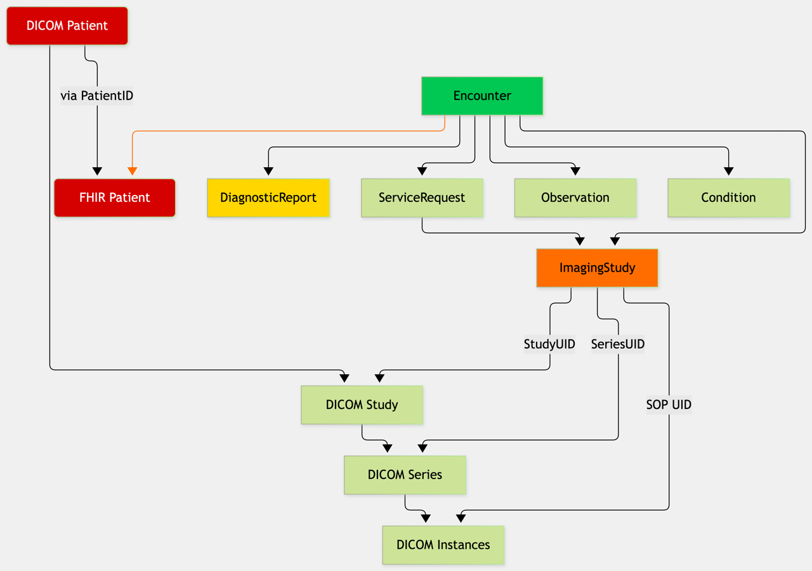

# Gosmart.Health GRAPHITE (`gosmart-graphite`)

A high-performance **DICOM and FHIR Knowledge Graph** backend server powered by
**Python 3.14**, **FastAPI**, **Pydantic**, **Neo4j**, **pydicom**,
**pynetdicom**, and **Pykka**.



---

## Documentation

Full user-facing documentation — covering **Getting Started**, **Docker & Local
Installation**, **Configuration** (`GOSMART_GS_*`, DICOM, FHIR, LLM,
Bootstrapping & Administration), **DICOM Conformance Statement**, **Cypher
Query Guide**, **Testing & Ecosystem**, and **MCP for AI Agents** — is hosted
at:

- **Online Documentation:** [https://gosmart.health/docs/graphite](https://gosmart.health/docs/graphite)

### Read the Documentation Locally (MkDocs)

You can also browse the complete documentation site directly from this
repository using MkDocs:

```bash
uv sync --group docs
cd docs/mkdocs
uv run --group docs mkdocs serve        # live preview at http://127.0.0.1:8000 (or run ./preview.sh)
```

To produce a static production build into `docs/mkdocs/site/`:

```bash
cd docs/mkdocs
uv run --group docs mkdocs build --strict --clean
```

---

## Key Capabilities

- **Unified DICOM + FHIR Knowledge Graph** — Models
  `(:Patient)-[:HAS_STUDY]->(:Study)-[:HAS_SERIES]->(:Series)-[:HAS_INSTANCE]->(:Instance)`
  alongside FHIR R4B resources in Neo4j with deterministic UUIDv5 IDs, audit
  metadata, and non-destructive `NOT_` soft deletion.
- **DICOM & DICOMweb Services** — Runtime-configurable multi-SCP lifecycle
  (`C-ECHO`, `C-STORE`, `C-FIND`, `C-GET`, `C-MOVE`), presentation-context
  enforcement, and RESTful `STOW-RS` / `WADO-RS` / `QIDO-RS`.
- **Actor-Based Concurrency** — Pykka actors (`DicomIngestionActor`,
  `FhirActor`, `AuditActor`, `StoreSCUActor`) for non-blocking background
  processing.
- **Storage-Agnostic Media Service** — Unified async interface for local disk,
  GCS (`gs://`), S3 (`s3://`), Azure Blob (`az://`), and Windows UNC shares.
- **Vector Embeddings & GraphRAG** — Group-scoped `LLM_Config` nodes resolved
  via Genkit (Ollama and Google Vertex AI / Gemini).
- **Security & Auth** — JWT access/refresh tokens, API keys (`gs_live_`),
  Google OAuth2/OIDC, scoped RBAC, and Argon2 password hashing.
- **Built-in MCP Server & CLI** — StreamableHTTP, SSE, and STDIO transports for
  AI agents (Cursor, Cline, AntiGravity), plus the `gosmart-graphite` /
  `gosmart-gs` CLI.

---

## Quick Start

### Docker Compose (Full Stack: GRAPHITE + Neo4j)

```bash
cp .env.example .env
docker compose -f docker/docker-compose.yml up -d --build
```

### Local Development (`uv` + Existing Neo4j)

```bash
uv sync
cp .env.example .env                    # edit GOSMART_GS_* values
./devop-scripts/scaffold_configs.sh     # optional: register starter DICOM/FHIR/LLM configs
./start.sh                              # Windows PowerShell: .\start.ps1
```

Once running, interactive API docs are available at
[http://localhost:8086/docs](http://localhost:8086/docs) (Swagger UI) and
[http://localhost:8086/redoc](http://localhost:8086/redoc) (ReDoc).

For full setup instructions, environment variables, administration, and MCP
client configuration, see
[https://gosmart.health/docs/graphite](https://gosmart.health/docs/graphite)
(or run `mkdocs serve` locally as shown above).

---

## Development & Repository Reference

### Tests & Linting Gates

```bash
# Self-contained unit tests (no Neo4j or external services required)
uv run pytest tests/unit --verbose

# Code quality checks
uv run ruff check .
uv run ruff format --check .
```

### In-Repo Engineering & Ops Resources

- [MkDocs Documentation Guide](./docs/mkdocs/README.md)
- [Design Controls & Regulatory Specifications](./docs/design/README.md)
- [DevOps Scripts Guide](./devop-scripts/README.md)
- [Local Neo4j Docker Guide](./neo4j-local-docker/README.md)
- [Interactive Exploration Notebook](./notebooks/exploration.ipynb)
- [License (Apache-2.0)](./LICENSE)
