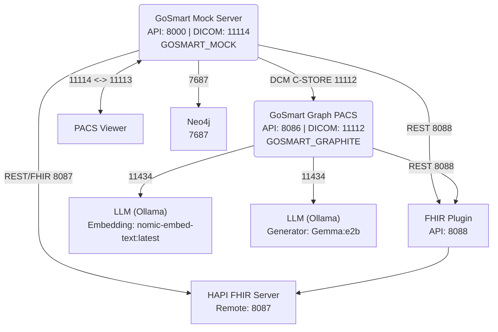
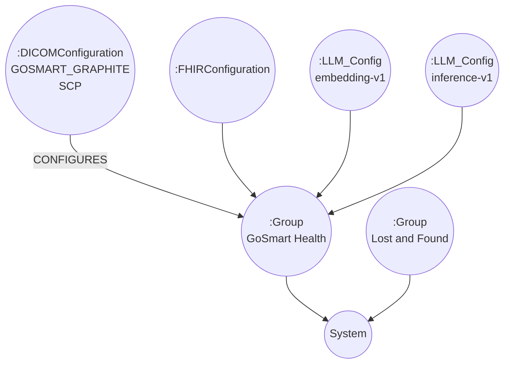
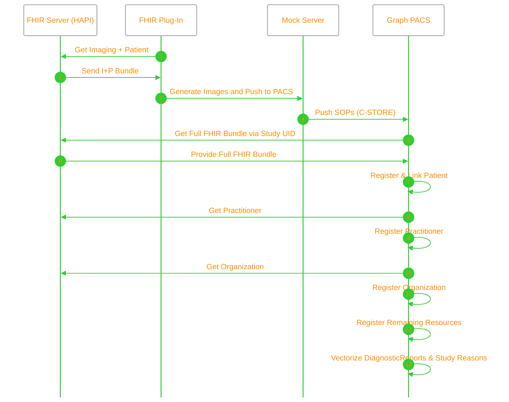

# Gosmart.Health GRAPHITE (`gosmart-graphite`)

A high-performance DICOM and FHIR Knowledge Graph backend server powered by **Python 3.14**, **FastAPI**, **Pydantic**, **Neo4j**, **pydicom**, **pynetdicom**, and **Pykka**.


## Contents

- [Features](#features)
- [Project Structure](#project-structure)
- [Storage-Agnostic Media Service](#storage-agnostic-media-service)
- [Environment Variables (`GOSMART_GS_*`)](#environment-variables-gosmart_gs_)
- [Getting Started](#getting-started)
- [CLI Reference](#cli-reference)
- [REST API & MCP Overview](#rest-api--mcp-overview)
- [System Bootstrapping & Administration](#system-bootstrapping--administration)
- [Model Context Protocol (MCP) Configuration](#model-context-protocol-mcp-configuration)
- [Testing & Verification](#testing--verification)
- [GoSmart Testing Ecosystem](#gosmart-testing-ecosystem)
- [Additional Documentation](#additional-documentation)

---

## Features

- **FastAPI & Pydantic**: Async REST API endpoints with automated OpenAPI schemas (`/docs` and `/redoc`), strong typing, and request/response validation.
- **Neo4j Knowledge Graph**: Models the DICOM hierarchy `(:Patient)-[:HAS_STUDY]->(:Study)-[:HAS_SERIES]->(:Series)-[:HAS_INSTANCE]->(:Instance)` alongside FHIR R4B resources with uniqueness constraints and indexed lookups.
- **Auditable & Immutable Entity System**: Nodes and relationships derive from `Auditable` with deterministic UUIDv5 IDs from canonical JSON property subsets, `test_id` telemetry isolation, UTC Cypher timestamps (`CreatedAt`, `ActedAt`, `ExpiresAt`), and immutable action metadata (`Action`, `ActedBy`).
- **Reserved `NOT_` Relationship Semantics**: Non-destructive soft deletion executing atomic property-cloning swaps to `NOT_<rel_type>` within managed Neo4j write transactions.
- **pydicom & pynetdicom**: DICOM header parsing, file persistence, mock dataset generation, and network operations (`C-ECHO` SCU, `C-STORE` SCP/SCU, Verification).
- **DICOMweb Standard**: RESTful DICOMweb services (`STOW-RS`, `WADO-RS`, `QIDO-RS`) for web-native DICOM interoperability.
- **Pykka Concurrency**: Actor model (`DicomIngestionActor`, `AuditActor`, `FhirActor`, `StoreSCUActor`) for non-blocking asynchronous DICOM ingestion, FHIR synchronization, audit logging, and outbound `C-STORE` SCU transfers.
- **Dynamic DICOM SCP Lifecycle**: Runtime-configurable SCP instances with presentation context enforcement, service class negotiation, and graceful draining of active associations.
- **Authentication & Authorization**: JWT access/refresh tokens, API key authentication (`gs_live_` prefix), Google OAuth2 / OIDC federated login, scoped RBAC with DICOM-level authorization, and Argon2 password hashing.
- **Model Context Protocol (MCP)**: Built-in MCP server supporting **StreamableHTTP**, **SSE**, and **STDIO** transports for AI agent integration (Cursor, Cline, AntiGravity).
- **Vector Embedding Service**: Unified text embedding generation (`EmbeddingService`) powered by **Genkit** (`genkit-ollama` and `genkit-google-genai`), dynamically resolved from Neo4j `(:LLM_Config)` nodes scoped to sponsoring `(:Group)` hierarchies (falling back to `'GoSmart Health'`), supporting Ollama and Google Vertex AI / Gemini models, Matryoshka `dimensions_truncated`, and L2 normalization.
- **Audit Trail**: Structured `structlog` logging with configurable rotation, Neo4j persistence, and background `AuditActor` writes.
- **Docker & Docker Compose**: Multi-stage Dockerfile with full-stack `docker compose` orchestration (Graph Server + Neo4j), health checks, named volumes, and an unprivileged runtime user.
- **CLI Management Tools**: Typer-based CLI (`gosmart-graphite` / `gosmart-gs`) for server operation, DICOM networking, MCP hosting, and runtime configuration (`start`, `health`, `mock`, `ingest`, `patients`, `query`, `echo`, `send`, `mcp`, `configure`), plus an out-of-band administrative CLI (`gosmart_graphite.cli.admin`).
- **CI/CD Pipeline**: GitHub Actions workflow with Ruff linting and formatting checks, `pip-audit` vulnerability scanning, CycloneDX SBOM generation, automated unit tests, and Docker build verification.
- **UV & Python 3.14**: Dependency and virtual environment management via Astral `uv`.
- **Interactive Notebooks**: Ready-to-run Jupyter notebooks for exploring library capabilities, embeddings, and validation workflows.

---

## Project Structure

```text
gosmart-graphite/
├── src/
│   └── gosmart_graphite/             # Application package
│       ├── actor/                    # Pykka actor system
│       │   ├── audit_actor.py        # Background audit logging actor
│       │   ├── dicom_ingestion_actor.py  # Async DICOM ingestion actor
│       │   ├── fhir_actor.py         # Background FHIR polling & graph sync actor
│       │   └── store_scu_actor.py    # Outbound C-STORE SCU transfer actor
│       ├── api/v1/
│       │   ├── endpoints/
│       │   │   ├── auth.py           # Registration, login, refresh, OAuth2, API keys
│       │   │   ├── dicom.py          # Upload, mock generator, and C-ECHO endpoints
│       │   │   ├── dicomweb.py       # DICOMweb REST services (STOW-RS, WADO-RS, QIDO-RS)
│       │   │   ├── graph.py          # Graph traversal, soft-delete, and Cypher endpoints
│       │   │   ├── health.py         # Health status (Neo4j, Pykka, Storage)
│       │   │   ├── llm.py            # Dynamic group-scoped LLM configuration endpoints
│       │   │   └── system.py         # System metadata, DICOM configs, bootstrap, cleanup
│       │   └── router.py             # Aggregated v1 API router
│       ├── cli/                      # Administrative & configuration CLI modules
│       │   ├── admin.py              # Out-of-band admin & API key CLI (`python -m gosmart_graphite.cli.admin`)
│       │   └── configure.py          # Neo4j config registration (`configure llm-config|dicom-config|fhir-config`)
│       ├── core/                     # Application settings, security, & logging
│       │   ├── auth_dependency.py    # FastAPI dependency for JWT / API key auth
│       │   ├── config.py             # Pydantic Settings (`GOSMART_GS_*` prefix)
│       │   ├── logging.py            # Structured logging (structlog) with rotation
│       │   └── security.py           # JWT signing, Argon2 hashing, API key utilities
│       ├── db/                       # Database connectivity & consolidated Cypher schema scripts
│       │   ├── config_schema.cypher  # DICOM, FHIR, & LLM configuration constraints & indexes
│       │   ├── dicom_schema.cypher   # DICOM Patient/Study/Series/Instance constraints
│       │   ├── embedding_schema.cypher # Vector embedding node constraints & indexes (placeholder)
│       │   ├── fhir_schema.cypher    # FHIR R4B Neo4j schema constraints & indexes
│       │   ├── neo4j.py              # Neo4j async/sync client & connection pooling
│       │   ├── schema_loader.py      # Explicit-manifest Cypher schema loader & line-accurate parser
│       │   └── system_schema.cypher  # System, Auth, Group, AuditLog constraints & BELONGS_TO indexes
│       ├── model/                    # Pydantic domain models
│       │   ├── actor_message.py      # Pykka actor message schemas
│       │   ├── audit.py              # Audit log and audit trail models
│       │   ├── auditable.py          # Auditable, AuditableNode, AuditableRelation, ID & negation helpers
│       │   ├── auth.py               # JWT token, API key, OAuth models
│       │   ├── dicom.py              # Patient, Study, Series, Instance models
│       │   ├── dicom_config.py       # DICOMConfiguration node, relation, and API DTOs
│       │   ├── fhir/                 # FHIR R4B graph node & relationship models
│       │   ├── fhir_config.py        # FHIRConfiguration models
│       │   ├── graph.py              # Cypher and graph schema models
│       │   ├── health.py             # Health response models
│       │   ├── llm_config.py         # LLM_Config, HasLlmConfigRelation, and LLM API DTOs
│       │   ├── media.py              # StorageScheme, ParsedStorageUri, MediaMetadata
│       │   └── system.py             # System bootstrap, response, update, and test cleanup DTOs
│       ├── service/                  # Business logic services
│       │   ├── dicom_service.py      # pydicom parsing, mock generation, storage save
│       │   ├── dicomweb_service.py   # DICOMweb STOW-RS, WADO-RS, QIDO-RS logic
│       │   ├── embedding_service.py  # Genkit vector embedding computation
│       │   ├── fhir_config_service.py# Group-scoped FHIRConfiguration management
│       │   ├── fhir_service.py       # FHIR R4B fetching and Neo4j graph upsert
│       │   ├── graph_service.py      # Cypher queries for DICOM & FHIR hierarchy
│       │   ├── group_service.py      # Organization and group management
│       │   ├── llm_config_service.py # Group-scoped LLM_Config persistence & resolution
│       │   ├── mcp_service.py        # MCP server (StreamableHTTP, SSE, STDIO)
│       │   ├── media_service.py      # Storage-agnostic async media service
│       │   ├── pynetdicom_service.py # Dynamic SCP lifecycle & C-STORE/C-ECHO AE
│       │   ├── system_service.py     # System bootstrap & DICOM configuration service
│       │   └── user_service.py       # User CRUD, admin bootstrap, password management
│       ├── cli.py                    # Typer CLI entrypoint (`gosmart-graphite` / `gosmart-gs`)
│       └── main.py                   # FastAPI application factory & Uvicorn entrypoint
├── devop-scripts/                    # DevOps, configuration scaffolding, & cleanup utilities
├── docker/
│   ├── Dockerfile                    # Multi-stage Docker build (Python 3.14 + uv)
│   └── docker-compose.yml            # Full-stack compose (Graph Server + Neo4j)
├── docs/                             # Design specs, DICOM conformance statement, & user guides
├── neo4j-local-docker/
│   ├── docker-compose.yaml           # Standalone Neo4j container for local development
│   └── README.md                     # Neo4j local Docker setup guide
├── notebooks/                        # Interactive Jupyter notebooks (exploration, embeddings, validation)
├── tests/
│   ├── assets/mr/                    # MR DICOM validation test assets
│   ├── rest-client/                  # VS Code REST Client scripts (`.http` files)
│   ├── unit/                         # Self-contained unit tests (run in CI)
│   ├── integration/                  # Neo4j & multi-component integration tests
│   ├── live/                         # External FHIR, MDICOM, MCP, & Gemini tests
│   ├── utils/                        # Shared test configuration utilities
│   ├── configs.json                  # Local integration/live test configuration
│   └── conftest.py                   # Shared fixtures and actor cleanup
├── .dockerignore                     # Docker build context exclusions
├── .env.example                      # Environment variable template
├── .github/workflows/ci.yml          # CI pipeline (lint, audit, SBOM, tests, Docker build)
├── pyproject.toml                    # Project metadata, scripts, and dependencies
├── start.ps1                         # Local development launch script (PowerShell)
├── start.sh                          # Local development launch script (POSIX)
└── uv.lock                           # Locked dependency versions
```

---

## Storage-Agnostic Media Service

`gosmart-graphite` provides a unified, storage-agnostic [`MediaService`](src/gosmart_graphite/service/media_service.py) that abstracts file operations across local storage, Windows UNC shares, and cloud object stores.

### Supported URI Schemes

| Provider / Target        | URI Scheme Prefix                  | Example URI                                 |
|:-------------------------|:-----------------------------------|:--------------------------------------------|
| **Google Cloud Storage** | `gs://` (or `gcs://`)              | `gs://my-dicom-bucket/mr_studies/MR.01.dcm` |
| **Amazon S3**            | `s3://` (or `s3a://`)              | `s3://my-dicom-bucket/mr_studies/MR.01.dcm` |
| **Azure Blob Storage**   | `az://` (or `azure://`, `abfs://`) | `az://dicom-container/mr_studies/MR.01.dcm` |
| **Local File**           | `file://` (or absolute path)       | `file:///data/storage/MR.01.dcm`            |
| **Windows UNC**          | Backslash (`\\` or `\`)            | `\\hospital-nas\imaging_share\MR.01.dcm`    |

### Cloud Credentials (Standard SDK Environment Variables)

The service resolves credentials automatically from standard SDK environment variables (or their `GOSMART_GS_*`-prefixed equivalents):

- **GCP**: `GOOGLE_APPLICATION_CREDENTIALS` (JSON key file path), `GOOGLE_CLOUD_PROJECT` / `GCP_PROJECT`, `GCS_ENDPOINT_URL` (emulator host)
- **AWS**: `AWS_ACCESS_KEY_ID`, `AWS_SECRET_ACCESS_KEY`, `AWS_SESSION_TOKEN`, `AWS_DEFAULT_REGION` / `AWS_REGION`, `AWS_ENDPOINT_URL`
- **Azure**: `AZURE_STORAGE_CONNECTION_STRING`, `AZURE_STORAGE_ACCOUNT_NAME`, `AZURE_STORAGE_ACCOUNT_KEY`, `AZURE_STORAGE_SAS_TOKEN`

### Asynchronous & Actor Execution

All core `MediaService` operations (`read`, `write`, `exists`, `delete`, `stat`, `list_files`, `copy`, `move`, `read_dicom`, `write_dicom`) are `async`. For Pykka worker threads (such as `pykka.ThreadingActor`) or synchronous scripts, `run_sync()` and synchronous wrappers (`read_sync`, `write_sync`, etc.) avoid event-loop deadlocks.

---

## Environment Variables (`GOSMART_GS_*`)

Settings are loaded from environment variables and `.env` via [`Settings`](src/gosmart_graphite/core/config.py):

| Variable | Default Value | Description |
|:---------|:--------------|:------------|
| **Database (Neo4j)** | | |
| `GOSMART_GS_DB_CONNECTION_URI` | `bolt://localhost:7687` | Neo4j connection URI (also accepts `NEO4J_URI`) |
| `GOSMART_GS_DB_USER` | `neo4j` | Neo4j username (also accepts `NEO4J_USERNAME`) |
| `GOSMART_GS_DB_PASSWORD` | `password` | Neo4j password (also accepts `NEO4J_PASSWORD`) |
| `GOSMART_GS_DB_DATABASE` | `neo4j` | Neo4j database name (also accepts `NEO4J_DATABASE`) |
| `GOSMART_GS_DB_MAX_CONNECTION_POOL_SIZE` | `50` | Neo4j maximum connection pool size |
| `GOSMART_GS_DB_MAX_CONNECTION_LIFETIME` | `3600` | Neo4j maximum connection lifetime (seconds) |
| `GOSMART_GS_DB_CONNECT_RETRY_TIMEOUT_SEC` | `600` | Production mode (`GOSMART_GS_DEV_MODE=false`) max total seconds to keep retrying Neo4j connectivity during startup (`0` = retry indefinitely) |
| `GOSMART_GS_DB_CONNECT_RETRY_INITIAL_DELAY_SEC` | `2.0` | Initial exponential backoff delay (seconds) between Neo4j connectivity retries |
| `GOSMART_GS_DB_CONNECT_RETRY_MAX_DELAY_SEC` | `30.0` | Maximum exponential backoff delay (seconds) between Neo4j connectivity retries |
| **FHIR** | | |
| `GOSMART_GS_FHIR_BASE_URL` | *(empty)* | FHIR server root URL; empty string disables FHIR polling |
| `GOSMART_GS_FHIR_POLL_SEC` | `120` | FHIR polling interval (seconds) for `DiagnosticReport` resources |
| `GOSMART_GS_FHIR_ACCESSION_SYSTEM` | *(empty)* | Identifier system URI for Accession Number |
| `GOSMART_GS_FHIR_PATIENT_ID_SYSTEM` | `urn:oid:2.16.840.1.113883.4.3.25` | Identifier system URI for Patient ID / MRN |
| **LLM Configuration Security** | | *(LLM providers, models, and endpoints are persisted dynamically in Neo4j as `LLM_Config` nodes; see `configure llm-config`)* |
| `GOSMART_GS_LLM_CONFIG_ENCRYPTION_KEY` | *(none)* | Optional Fernet key or passphrase for encrypting stored `LLM_Config.api_key` values at rest in Neo4j |
| **Storage** | | |
| `GOSMART_GS_STORAGE_ROOT_URI` | `file:///tmp/gosmart_dicom_storage` | Storage root URI (`file://`, `gs://`, `s3://`, `az://`, `\\unc\share`) |
| **Server** | | |
| `GOSMART_GS_DEV_MODE` | `false` | Enable development mode (`true` relaxes offline Neo4j startup checks; `false` enforces production connectivity retries before failing hard) |
| `GOSMART_GS_HOST` | `0.0.0.0` | FastAPI host binding |
| `GOSMART_GS_PORT` | `8086` | FastAPI HTTP port |
| `GOSMART_GS_RELOAD` | `true` | Uvicorn auto-reload toggle |
| **Logging** | | |
| `GOSMART_GS_LOG_LEVEL` | `INFO` | Logging level (`DEBUG`, `INFO`, `WARNING`, `ERROR`, `CRITICAL`) |
| `GOSMART_GS_LOG_FORMAT` | `json` | Log format (`json` or `console`) |
| `GOSMART_GS_LOG_DIR` | `./logs` | Directory for rotating log files |
| `GOSMART_GS_LOG_FILE` | `gosmart_gs.log` | Base filename for rotating logs |
| `GOSMART_GS_LOG_ROTATION_DAYS` | `7` | Rotate log files every N days |
| `GOSMART_GS_LOG_BACKUP_COUNT` | `8` | Number of rotated backup log files to retain |
| `GOSMART_GS_LOG_TO_FILE` | `true` | Enable rotating file logging |
| **DICOM Network** | | |
| `GOSMART_GS_DICOM_AE_TITLE` | `GOSMART_GRAPHITE` | Default local DICOM Application Entity Title |
| `GOSMART_GS_DICOM_SCP_PORT` | `11112` | Default DICOM `C-STORE` / `C-ECHO` SCP port |
| `GOSMART_GS_DICOM_MAX_PDU` | `16382` | Maximum PDU length in bytes |
| **Authentication & Security** | | |
| `GOSMART_GS_JWT_SECRET_KEY` | *(dev secret)* | Secret key for signing and verifying JWT tokens (override in production) |
| `GOSMART_GS_JWT_ALGORITHM` | `HS256` | JWT signing algorithm |
| `GOSMART_GS_JWT_ACCESS_TOKEN_EXPIRE_MINUTES` | `60` | Access token expiration (minutes) |
| `GOSMART_GS_JWT_REFRESH_TOKEN_EXPIRE_DAYS` | `30` | Refresh token expiration (days) |
| `GOSMART_GS_API_KEY_PREFIX` | `gs_live_` | Prefix for generated API keys |
| `GOSMART_GS_GOOGLE_OAUTH_CLIENT_ID` | *(none)* | Google OAuth2 / OIDC Client ID for federated login |
| `GOSMART_GS_GOOGLE_OAUTH_CLIENT_SECRET` | *(none)* | Google OAuth2 Client Secret |
| **Admin Bootstrapping** | | |
| `GOSMART_GS_INITIAL_ADMIN_EMAIL` | `admin@gosmart.health` | Bootstrap Platform Admin primary email |
| `GOSMART_GS_INITIAL_ADMIN_PASSWORD` | *(none)* | Bootstrap Platform Admin initial password |
| `GOSMART_GS_INITIAL_ADMIN_USERNAME` | `admin` | Bootstrap Platform Admin username |
| `GOSMART_GS_INITIAL_ADMIN_DISPLAY_NAME` | `System Administrator` | Bootstrap Platform Admin display name |
| `GOSMART_GS_FORCE_ADMIN_PASSWORD_RESET` | `false` | Force-reset admin password to `GOSMART_GS_INITIAL_ADMIN_PASSWORD` on startup |
| **Audit** | | |
| `GOSMART_GS_AUDIT_RETENTION_DAYS` | `365` | Audit log retention period in days |
| `GOSMART_GS_AUDIT_LOG_TO_DB` | `true` | Enable Neo4j persistence for audit logs |
| **Cloud Storage (Optional)** | | |
| `GOOGLE_APPLICATION_CREDENTIALS` | *(none)* | GCP service account JSON key file path |
| `GOOGLE_CLOUD_PROJECT` | *(none)* | Google Cloud Project ID |
| `GCS_ENDPOINT_URL` | *(none)* | Custom GCS endpoint URL (emulator) |
| `AWS_ACCESS_KEY_ID` | *(none)* | AWS access key ID |
| `AWS_SECRET_ACCESS_KEY` | *(none)* | AWS secret access key |
| `AWS_DEFAULT_REGION` | *(none)* | AWS region |
| `AWS_ENDPOINT_URL` | *(none)* | Custom S3 endpoint URL (MinIO, LocalStack, etc.) |
| `AZURE_STORAGE_CONNECTION_STRING` | *(none)* | Azure Blob Storage connection string |
| `AZURE_STORAGE_ACCOUNT_NAME` | *(none)* | Azure Storage account name |
| `AZURE_STORAGE_ACCOUNT_KEY` | *(none)* | Azure Storage account key |
| `AZURE_STORAGE_SAS_TOKEN` | *(none)* | Azure Storage SAS token |

---

## Getting Started

### 1. Installation

Dependencies and the Python 3.14 environment are managed with `uv`:

```bash
uv sync
```

Copy the environment template and adjust values for your local environment:

```bash
cp .env.example .env
```

### 2. Run Locally Without Docker (Recommended for Developers)

> [!TIP]
> To replicate the full multi-service test setup locally, see [GoSmart Testing Ecosystem](#gosmart-testing-ecosystem).

#### Optional: Reset or Clean Up Database Data

To wipe the entire Neo4j database and reset the system to defaults before starting the server, run the following Cypher query in Neo4j Browser. Once the server starts, you can register remote AEs using the scripts in [tests/rest-client/](./tests/rest-client/) with the VS Code REST Client extension.

```cypher
MATCH (n)
DETACH DELETE n;
```

To clear only ingested DICOM/FHIR data between test cycles while preserving configurations and users, run [devop-scripts/cleanup-data.py](./devop-scripts/cleanup-data.py):

```bash
uv run devop-scripts/cleanup-data.py
```

#### Scaffold Initial Configurations

You can register initial DICOM, FHIR, and LLM configurations in Neo4j before starting the server using [devop-scripts/scaffold_configs.sh](./devop-scripts/scaffold_configs.sh):

```bash
./devop-scripts/scaffold_configs.sh
```

#### Start the Server

Ensure `.env` is configured and Neo4j is running, then launch GRAPHITE:

- On Linux/macOS:
  ```bash
  ./start.sh
  ```

- On Windows (PowerShell):
  ```powershell
  .\start.ps1
  ```

Interactive API documentation will be available at:

- **Swagger UI**: [http://localhost:8086/docs](http://localhost:8086/docs)
- **ReDoc**: [http://localhost:8086/redoc](http://localhost:8086/redoc)

### 3. Run with Docker & Docker Compose

Docker provides the fastest path to a full stack running both the Graph Server and Neo4j.

#### Prerequisites

- [Docker Desktop](https://www.docker.com/products/docker-desktop/) installed and running
- *(Optional)* Copy `.env.example` to `.env` and customize values before building:
  ```bash
  cp .env.example .env
  ```

#### Option A: Full-Stack Launch (Recommended)

From the repository root, [docker/docker-compose.yml](./docker/docker-compose.yml) orchestrates both **Gosmart.Health GRAPHITE** and **Neo4j**:

```bash
docker compose -f docker/docker-compose.yml up -d --build
```

Services started:

| Service          | Container Name     | Ports                              | Description                                |
|:-----------------|:-------------------|:-----------------------------------|:-------------------------------------------|
| **Graph Server** | `gosmart-graphite` | `8086` (HTTP), `11112` (DICOM SCP) | FastAPI REST API, MCP endpoints, DICOM SCP |
| **Neo4j**        | `gosmart-neo4j`    | `7474` (Browser), `7687` (Bolt)    | Graph database with health check           |

Service endpoints after launch:

- **Swagger UI**: [http://localhost:8086/docs](http://localhost:8086/docs)
- **ReDoc**: [http://localhost:8086/redoc](http://localhost:8086/redoc)
- **Health Check**: [http://localhost:8086/api/v1/health](http://localhost:8086/api/v1/health)
- **MCP StreamableHTTP**: [http://localhost:8086/mcp](http://localhost:8086/mcp)
- **MCP SSE**: [http://localhost:8086/sse](http://localhost:8086/sse)
- **Neo4j Browser**: [http://localhost:7474](http://localhost:7474)
- **DICOM SCP**: `GOSMART_GS@localhost:11112` (configured in `docker/docker-compose.yml`)

Named volumes for persistent data:

- `neo4j_data` — Neo4j database files
- `neo4j_logs` — Neo4j log files
- `dicom_storage` — Persisted DICOM files (`C-STORE` received instances)
- `server_logs` — Application log files with auto-rotation

Stop the stack:

```bash
docker compose -f docker/docker-compose.yml down
```

Stop the stack and remove all persistent volumes:

```bash
docker compose -f docker/docker-compose.yml down -v
```

#### Option B: Build Standalone Image

Build the Docker image independently:

```bash
docker build -t gosmart-graphite -f docker/Dockerfile .
```

Run standalone against an external Neo4j instance:

```bash
docker run -d \
  --name gosmart-graphite \
  -p 8086:8086 \
  -p 11112:11112 \
  -e GOSMART_GS_DB_CONNECTION_URI=bolt://host.docker.internal:7687 \
  -e GOSMART_GS_DB_PASSWORD=your_password \
  -e GOSMART_GS_INITIAL_ADMIN_PASSWORD=MySecurePassword123! \
  gosmart-graphite
```

#### Dockerfile Architecture

[docker/Dockerfile](./docker/Dockerfile) uses a **multi-stage build** for small image size and hardened execution:

| Stage       | Base Image         | Purpose                                                                                |
|:------------|:-------------------|:---------------------------------------------------------------------------------------|
| **Builder** | `python:3.14-slim` | Installs `uv`, compiles C-extensions, and syncs locked production dependencies         |
| **Runner**  | `python:3.14-slim` | Minimal runtime with `curl` for health checks, running as `appuser` (UID/GID `10001`)  |

Key design choices:

- **Layer caching**: `pyproject.toml` and `uv.lock` are copied first so dependency installs are cached when only source files change.
- **Unprivileged user**: The runtime container executes as `appuser:appuser` (`10001:10001`), not `root`.
- **Health check**: Built-in `HEALTHCHECK` polls `GET /api/v1/health` every 30 seconds.
- **Exposed ports**: `8086` (HTTP API) and `11112` (DICOM SCP).

#### Option C: Neo4j-Only Docker (Local Development)

When running the FastAPI server natively with `uv`, you can run Neo4j alone in Docker:

```bash
docker compose -f neo4j-local-docker/docker-compose.yaml up -d
```

See [neo4j-local-docker/README.md](./neo4j-local-docker/README.md) for details.

#### Overriding Environment Variables

`docker/docker-compose.yml` provides local development defaults. To override variables, either:

1. Edit the `environment:` section in `docker/docker-compose.yml`, or
2. Pass an external `.env` file with `--env-file`:
   ```bash
   docker compose -f docker/docker-compose.yml --env-file .env up -d
   ```

> [!TIP]
> Inside Docker Compose, the Graph Server reaches Neo4j over the Compose network at `bolt://neo4j:7687`.

---

## CLI Reference

### Core CLI (`gosmart-graphite`)

The Typer-based CLI ([`cli.py`](src/gosmart_graphite/cli.py), exposed as `gosmart-graphite` and `gosmart-gs`) provides operational and configuration commands:

```bash
# Start the FastAPI server
uv run gosmart-graphite start --host 0.0.0.0 --port 8086 --reload

# Check system health (Neo4j, Pykka Actors, Storage)
uv run gosmart-graphite health

# Generate and ingest a mock DICOM instance
uv run gosmart-graphite mock --patient-id PT-CLI-001 --modality CT

# Ingest a local DICOM file (pass --actor to dispatch via Pykka)
uv run gosmart-graphite ingest /path/to/file.dcm --actor

# List indexed patients or run a Cypher query
uv run gosmart-graphite patients --limit 50
uv run gosmart-graphite query "MATCH (p:Patient) RETURN p.patient_id LIMIT 10"

# Send C-ECHO to a remote DICOM AE
uv run gosmart-graphite echo --called-aet REMOTE_AE --host 192.168.1.100 --port 104

# Send DICOM files to a remote AE via Store SCU Actor
uv run gosmart-graphite send /path/to/dicom/ --dest-aet REMOTE_AE --host 192.168.1.100 --port 104

# Run standalone MCP server (SSE, StreamableHTTP, or STDIO)
uv run gosmart-graphite mcp --transport sse --port 8001
uv run gosmart-graphite mcp --transport streamable-http --port 8001
uv run gosmart-graphite mcp --transport stdio

# Register or overwrite group-scoped configurations in Neo4j
uv run gosmart-graphite configure llm-config --file devop-scripts/llm_config.template.json
uv run gosmart-graphite configure llm-config --file /path/to/llm_config.json --assign "GoSmart Health"
uv run gosmart-graphite configure dicom-config --file devop-scripts/dicom_config.template.json
uv run gosmart-graphite configure fhir-config --file devop-scripts/fhir_config.template.json
```

### Administrative CLI (`gosmart_graphite.cli.admin`)

Out-of-band administrator and API key management is available via [`cli/admin.py`](src/gosmart_graphite/cli/admin.py):

```bash
# List Platform Administrators
uv run python -m gosmart_graphite.cli.admin list-admins

# Create a new Platform Administrator
uv run python -m gosmart_graphite.cli.admin create-admin --username emergency_admin --email emergency@gosmart.health

# Reset an existing user's password
uv run python -m gosmart_graphite.cli.admin reset-password --email admin@gosmart.health

# Generate an API key for MCP agents or integrations
uv run python -m gosmart_graphite.cli.admin create-api-key --email admin@gosmart.health --name "Agent Key" --scopes "mcp:full,graph:read"
```

---

## REST API & MCP Overview

On startup, the server automatically bootstraps an immutable root `(:System)` node linked to a primary promiscuous DICOM entry (`ae_title = "*"`).

### Authentication Headers

Protected REST and MCP endpoints accept either:

- **API Key** (`X-API-Key: gs_live_...` or `Authorization: Bearer gs_live_...`)
- **JWT Access Token** (`Authorization: Bearer <access_token>`), obtained via `/api/v1/auth/login` or `/api/v1/auth/oauth/google`

Using `X-API-Key` is typically simplest for scripts and automated integrations. See [Out-of-Band API Key Generation](#3-out-of-band-api-key-generation) for instructions on creating keys.

### Key System, DICOM, & LLM Endpoints

*(See `/docs` for the full OpenAPI schema covering Auth, DICOM, DICOMweb, Graph, and Health endpoints.)*

- `GET /api/v1/system` — Inspect root `System` metadata (`name`, `owner`, `address`, `email`, `phone`, `serial_number`, `installed_at`) and attached configurations.
- `PUT /api/v1/system` — Update mutable `System` properties.
- `POST /api/v1/system/bootstrap` — Idempotent environment bootstrap.
- `POST /api/v1/system/test/cleanup` — Detach and delete test nodes across target labels where `test_id` is defined and non-empty; drains associated ephemeral test SCP instances.
- `GET /api/v1/configurations/dicom` — Query active DICOM configurations (filters: `role`, `is_promiscuous`, `is_local`, `include_tests`, `test_id`).
- `POST /api/v1/configurations/dicom` — Register a new `DICOMConfiguration` node and dynamically launch an SCP if `roles` includes `SCP`.
- `GET /api/v1/configurations/dicom/{config_id}` — Retrieve a single DICOM configuration.
- `PUT /api/v1/configurations/dicom/{config_id}` — Update DICOM configuration properties; drains in-flight association threads while launching the updated SCP instance.
- `DELETE /api/v1/configurations/dicom/{config_id}` — Soft-delete (or hard-delete with `?hard=true`); drains in-flight associations gracefully.
- `POST /api/v1/configurations/dicom/{config_id}/restore` — Restore a soft-deleted DICOM configuration and reactivate its SCP.
- `GET /api/v1/configurations/llm` — List active group-scoped `LLM_Config` nodes (`api_key` masked; filterable by `tag`, `provider`, `group_id`).
- `POST /api/v1/configurations/llm` — Register or overwrite a purpose-tagged `LLM_Config` (archives prior version via `NOT_HAS_LLM_CONFIG`) and assign it to a sponsoring `Group` (defaults to `'GoSmart Health'`; admin only).
- `GET /api/v1/configurations/llm/{config_id}` / `PUT /api/v1/configurations/llm/{config_id}` — Retrieve or update an `LLM_Config` (admin required for updates).
- `POST /api/v1/configurations/llm/{config_id}/assign` / `DELETE /api/v1/configurations/llm/{config_id}/groups/{group_id}` — Assign a sponsoring `Group` or soft-dissociate (`NOT_HAS_LLM_CONFIG`) (admin only).
- `DELETE /api/v1/configurations/llm/{config_id}` / `POST /api/v1/configurations/llm/{config_id}/restore` — Soft/hard delete or restore an `LLM_Config` (admin only).

### Dynamic SCP Lifecycle & Presentation Context Enforcement

- **Added**: Instantiates and launches a new SCP instance dynamically on its configured host, port, and AE title.
- **Changed**: Preserves existing association threads uninterrupted while launching a new SCP instance with the updated configuration.
- **Removed**: Transitions the SCP to draining state (stops accepting new associations while letting active transfer threads complete).
- **Service Class & Transfer Syntax Enforcement**: Negotiates presentation contexts strictly against configured `dicom_services` (SOP Classes) and `transfer_syntaxes`, rejecting unconfigured services or syntaxes during association negotiation.

### MCP Tools

The built-in MCP server ([`mcp_service.py`](src/gosmart_graphite/service/mcp_service.py)) exposes tools across four areas:

- **Health & Ingestion**: `health_check`, `generate_mock_dicom`, `ingest_dicom_file`, `echo_scu`, `store_scu`
- **Knowledge Graph**: `list_patients`, `get_patient_graph`, `soft_delete_relationship`, `restore_relationship`, `execute_cypher`
- **System & DICOM Configurations**: `get_system_info`, `update_system_info`, `bootstrap_system_defaults`, `list_dicom_configurations`, `get_dicom_configuration`, `create_dicom_configuration`, `update_dicom_configuration`, `delete_dicom_configuration`, `restore_dicom_configuration`
- **LLM Configurations**: `list_llm_configurations`, `get_llm_configuration`, `upsert_llm_configuration`, `assign_llm_configuration_to_group`, `dissociate_llm_configuration_from_group`, `delete_llm_configuration`, `restore_llm_configuration`

---

## System Bootstrapping & Administration

> [!CAUTION]
> **CRITICAL SECURITY REQUIREMENT: SERVER PLATFORM ACCESS CONTROL**
>
> The security model assumes that the host server platform, container execution environment, filesystem, environment variable configurations, and direct Neo4j database ports are **strictly access-controlled and hardened**.
>
> Direct shell access to the host/container or write access to environment variables enables out-of-band administrative privileges (such as password resets via CLI or `GOSMART_GS_FORCE_ADMIN_PASSWORD_RESET`). Restrict SSH, container exec, and configuration management access to authorized infrastructure administrators only.

### 1. Automated Superuser Bootstrapping

On startup, the server checks whether a Platform Administrator (`PLATFORM_ADMIN`) exists in Neo4j. If none exists and `GOSMART_GS_INITIAL_ADMIN_PASSWORD` is set, it creates the superuser account and affiliates it with the `'GoSmart Health'` Catch-All group:

```bash
# In .env or deployment environment:
GOSMART_GS_INITIAL_ADMIN_EMAIL=admin@gosmart.health
GOSMART_GS_INITIAL_ADMIN_PASSWORD=MySecurePassword123!
GOSMART_GS_INITIAL_ADMIN_USERNAME=admin
```

> [!NOTE]
> Bootstrapping is **idempotent**. On subsequent restarts, existing admin credentials and database state are preserved unless `GOSMART_GS_FORCE_ADMIN_PASSWORD_RESET=true` is explicitly enabled.

### 2. Out-of-Band Disaster Recovery & Password Reset

If an administrator loses access, two recovery mechanisms are available:

#### Mechanism A: Administrative CLI Utility (Host / Container)

Run [`cli/admin.py`](src/gosmart_graphite/cli/admin.py) directly on the host or inside the container:

```bash
# Reset an existing administrator's password
uv run python -m gosmart_graphite.cli.admin reset-password --email admin@gosmart.health --password "NewEmergencyPassword123!"

# Or omit --password to enter it securely via prompt
uv run python -m gosmart_graphite.cli.admin reset-password --email admin@gosmart.health

# Create a new Platform Administrator
uv run python -m gosmart_graphite.cli.admin create-admin --username emergency_admin --email emergency@gosmart.health

# List all Platform Administrators and their status
uv run python -m gosmart_graphite.cli.admin list-admins
```

#### Mechanism B: Startup Force-Reset Flag (`GOSMART_GS_FORCE_ADMIN_PASSWORD_RESET`)

For containerized environments (Docker / Kubernetes) where interactive CLI access is inconvenient:

1. Update environment variables in your deployment configuration:
   ```bash
   GOSMART_GS_INITIAL_ADMIN_EMAIL=admin@gosmart.health
   GOSMART_GS_INITIAL_ADMIN_PASSWORD=NewEmergencyPassword123!
   GOSMART_GS_FORCE_ADMIN_PASSWORD_RESET=true
   ```
2. Restart the container. On startup, the server updates the admin password hash and records a security audit log.
3. Log in with the new password and remove `GOSMART_GS_FORCE_ADMIN_PASSWORD_RESET=true`.

### 3. Out-of-Band API Key Generation

Generate scoped API keys directly via CLI for MCP agents, automation bots, and external integrations:

```bash
# Generate an API key for an administrator or user
uv run python -m gosmart_graphite.cli.admin create-api-key --email admin@gosmart.health --name "Cursor Agent Key"

# With custom scopes and 90-day expiration
uv run python -m gosmart_graphite.cli.admin create-api-key --email admin@gosmart.health --name "AntiGravity Agent Key" --scopes "mcp:full,graph:read" --expires-days 90
```

---

## Model Context Protocol (MCP) Configuration

Gosmart.Health GRAPHITE implements the [Model Context Protocol (MCP)](https://modelcontextprotocol.io/) over **StreamableHTTP** (`/mcp`), **SSE** (`/sse`), and **STDIO**.

### 1. Obtaining an API Key

MCP HTTP/SSE endpoints require authentication. Obtain an API key via either the **CLI** or the **REST API**.

#### Option A: Via Administrative CLI (Out-of-Band)

```bash
uv run python -m gosmart_graphite.cli.admin create-api-key --email admin@gosmart.health --name "Local Agent Key"
```

Example output:

```text
Successfully generated API key:
-----------------------------------------------------------------
  User ID:      eabebc72-5c2d-5b74-abfe-78aceb55a5fa
  User Email:   admin@gosmart.health
  Key Name:     Local Agent Key
  Scopes:       ['*']
  Expires At:   Never
  API Key:      gs_live_0123456789abcdef0123456789abcdef...
-----------------------------------------------------------------
```

#### Option B: Via REST API

1. **Log in as Administrator** to obtain an access token:
   ```bash
   curl -X POST "http://localhost:8086/api/v1/auth/login" \
     -H "Content-Type: application/json" \
     -d '{"username": "admin", "password": "YourAdminPassword123!"}'
   ```
   Extract `access_token` and user `id` from the JSON response.

2. **Generate the API Key**:
   ```bash
   curl -X POST "http://localhost:8086/api/v1/auth/api-keys" \
     -H "Content-Type: application/json" \
     -H "Authorization: Bearer <ACCESS_TOKEN>" \
     -d '{
       "user_id": "<USER_ID>",
       "name": "Cursor Agent Key",
       "scopes": ["*"]
     }'
   ```
   Save the returned `raw_api_key`.

### 2. Configuring MCP in Cursor

**Configuration Paths:**

- User home directory: `~/.cursor/mcp.json` *(macOS/Linux: `$HOME/.cursor/mcp.json`, Windows: `%USERPROFILE%\.cursor\mcp.json`)*
- Or workspace-level: `.cursor/mcp.json`

Example `~/.cursor/mcp.json` (SSE):

```json
{
  "mcpServers": {
    "gosmart-graphite": {
      "url": "http://127.0.0.1:8086/sse?api_key=gs_live_YOUR_API_KEY_HERE"
    }
  }
}
```

> [!TIP]
> To run MCP directly via STDIO in Cursor without a separate HTTP server:
> ```json
> {
>   "mcpServers": {
>     "gosmart-graphite": {
>       "command": "uv",
>       "args": [
>         "run",
>         "gosmart-graphite",
>         "mcp",
>         "--transport",
>         "stdio"
>       ],
>       "env": {
>         "GOSMART_MCP_API_KEY": "gs_live_YOUR_API_KEY_HERE"
>       }
>     }
>   }
> }
> ```

### 3. Configuring MCP in Cline

**Configuration Path:** `~/.cline/data/settings/cline_mcp_settings.json` (or via the Cline settings UI).

#### Option A: StreamableHTTP Transport (Recommended for high throughput)

```json
{
  "mcpServers": {
    "DICOM Server": {
      "url": "http://localhost:8086/mcp?api_key=gs_live_YOUR_API_KEY_HERE",
      "type": "streamableHttp",
      "disabled": false,
      "autoApprove": []
    }
  }
}
```

#### Option B: Server-Sent Events (SSE) Transport

```json
{
  "mcpServers": {
    "DICOM Server": {
      "url": "http://localhost:8086/sse?api_key=gs_live_YOUR_API_KEY_HERE",
      "type": "sse",
      "disabled": false,
      "autoApprove": []
    }
  }
}
```

### 4. Configuring MCP in AntiGravity

**Configuration Paths:**

- Global User Configuration: `~/.gemini/antigravity/mcp_config.json` *(macOS/Linux: `$HOME/.gemini/antigravity/mcp_config.json`, Windows: `%USERPROFILE%\.gemini\antigravity\mcp_config.json`)*
- Fallback locations: `~/.gemini/config/mcp_config.json` or `~/.gemini/antigravity-cli/mcp/mcp_config.json`

Example `~/.gemini/antigravity/mcp_config.json` (SSE):

```json
{
  "mcpServers": {
    "gosmart-graphite": {
      "serverUrl": "http://127.0.0.1:8086/sse?api_key=gs_live_YOUR_API_KEY_HERE"
    }
  }
}
```

Or using STDIO:

```json
{
  "mcpServers": {
    "gosmart-graphite": {
      "command": "uv",
      "args": [
        "run",
        "gosmart-graphite",
        "mcp",
        "--transport",
        "stdio"
      ],
      "env": {
        "GOSMART_MCP_API_KEY": "gs_live_YOUR_API_KEY_HERE"
      }
    }
  }
}
```

---

## Testing & Verification

### 1. Run Tests

Run the self-contained unit suite used by CI (no Neo4j, external API credentials, or running server required):

```bash
uv run pytest tests/unit --verbose
```

Run integration tests locally with Neo4j running (uses `test_id` values to isolate data and retains post-run data for inspection):

```bash
uv run pytest tests/integration --verbose
```

Run live tests after configuring the required external FHIR proxy, MicroDICOM server, MCP server, or Gemini API key (unavailable services are skipped where supported):

```bash
uv run pytest tests/live --verbose
```

Run all test suites locally:

```bash
uv run pytest
```

### 2. Code Quality & Linting Gates

```bash
uv run ruff check .
uv run ruff format --check .
```

### 3. DevOps Utilities (`devop-scripts`)

Scripts for GitHub Actions secret syncing, configuration scaffolding, and pre/post-test data cleanup live in [devop-scripts/](./devop-scripts/). See [devop-scripts/README.md](./devop-scripts/README.md) for usage details.

### 4. Interactive Notebooks

Open [notebooks/exploration.ipynb](./notebooks/exploration.ipynb) in your editor or start Jupyter Lab:

```bash
uv run jupyter lab notebooks/
```

`exploration.ipynb` walks through:

1. Environment and dependency verification
2. Configuration loading with the `GOSMART_GS_*` prefix
3. In-memory DICOM generation and parsing with `pydicom` into Pydantic models
4. Background Actor dispatch with `pykka` (`tell` and `ask`)
5. Graph queries and connectivity with `neo4j`
6. DICOM Application Entity (AE) setup and `C-ECHO` SCU ping with `pynetdicom`

---

## GoSmart Testing Ecosystem

You can use our suite of testing tools to validate a full GoSmart implementation locally:

- **GoSmart Mock Server**: Generates synthetic DICOM instances (Docker images available).
- **FHIR Plugin (PRO Subscription)**: Bridges GRAPHITE and commercial/open FHIR servers to test EHR integration and GraphRAG capabilities. Pro subscribers have access to combined Mock Server + FHIR Plugin Docker Compose environments.
- **HAPI FHIR Server**: Dockerized local FHIR server.
- **Synthea™**: Generates synthetic patients and clinical studies for loading into HAPI FHIR.
- **PACS Viewer**: On Windows, we recommend MicroDICOM viewer with DICOM Q/R and `C-MOVE`.
- **Neo4j**: Graph database backend. Works with Neo4j Aura Free or a local Neo4j Community Docker container.
- **LLM Server**: Host open-weight models locally via Ollama (selected embedding/generation models run within 6 GB of GPU memory) or connect to Google Vertex AI / Gemini via Genkit.

For more information on GoSmart tools, visit the [GoSmart Health Products Page](https://gosmart.health/products/).

GoSmart's FHIR Plug-In (for Professional clients) can also connect directly to commercial EHRs such as Epic and Redox via JWKS and OAuth2 over encrypted channels.

> [!NOTE]
> If Mermaid diagrams do not render in VS Code, install the **Markdown Preview Enhanced** extension.



### Default Group Hierarchy

GRAPHITE maintains a root node called `System`, beneath which top-level `Group` nodes are attached. By default, the system creates `GoSmart Health` and `Lost and Found` groups.

New top-level provider organizations are attached under `System`, while departmental sub-groups (such as `Radiology`) are attached beneath their parent organization group (e.g., `GoSmart Health`).

Groups hold references to scoped configurations—such as `LLM_Config`, `DICOMConfiguration`, and `FHIRConfiguration`—so separate organizations can use distinct credentials, endpoints, and billing accounts even when sharing the same underlying models. Example JSON templates and configuration files are provided under [devop-scripts/](./devop-scripts/).



### FHIR Process Sequence Diagram

This sequence illustrates how the FHIR Plug-In interacts with HAPI FHIR and the GoSmart Mock Server to generate DICOM images, push them to Graph PACS, and trigger FHIR resource synchronization and vectorization. *(Synchronous return arrows for standard `GET` requests are omitted for brevity.)*



---

## Additional Documentation

The user-facing product documentation site lives under [`docs/mkdocs/`](./docs/mkdocs/)
(MkDocs + Material for MkDocs). Build and preview it with:

```bash
uv sync --group docs
cd docs/mkdocs
uv run --group docs mkdocs serve                    # live preview at http://127.0.0.1:8000
uv run --group docs mkdocs build --strict --clean   # static site into docs/mkdocs/site/
```

It covers the project introduction, getting started, configuration, and MCP
usage (including natural-language utterance examples) for the public website.

In-repo reference documents:

- [Getting Started Guide](./docs/user_facing/1_getting_started.md)
- [Cypher Query Guide](./docs/user_facing/cypher_query_guide.md)
- [DICOM Conformance Statement](./docs/dicom_conformance_statement.md)
- [Design Specifications Index](./docs/design/README.md)
- [DevOps Scripts Guide](./devop-scripts/README.md)
- [Local Neo4j Docker Guide](./neo4j-local-docker/README.md)
