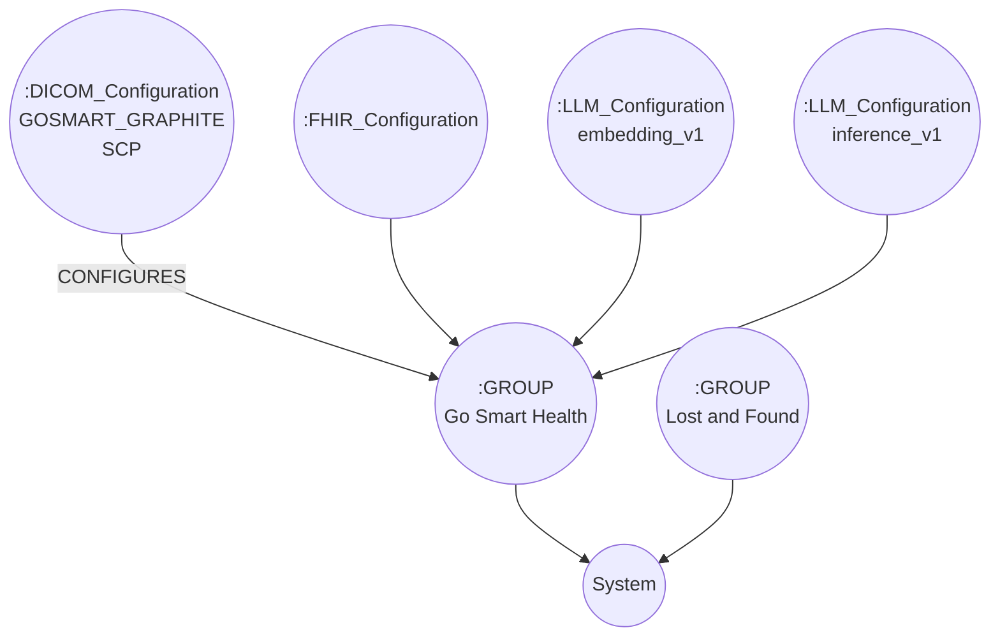

# DevOps Scripts

This directory contains various scripts and tools used for DevOps tasks.

> [!IMPORTANT]
> ## POSSIBLE PRODUCTION DATA OBLITERATION!
> These tools can cause complete loss of production data. Use with caution.
> ## POSSIBLE EXPOSURE OF SENSITIVE INFORMATION!
> These tools can expose sensitive information. Use with caution.
> Do not patch these tools or hard-code sensitive information into them.
> `.env` files should never be committed to version control.

## Command Line Configuration Tooling

The initial system configuration is as following:



```
Usage: gosmart-graphite configure [OPTIONS] COMMAND [ARGS]...                                                                                                                                                                                                                                                   
                                                                                                                                                                                                                                                                                                                 
 Configure runtime settings persisted in Neo4j.                                                                                                                                                                                                                                                                  
                                                                                                                                                                                                                                                                                                                 
╭─ Options ─────────────────────────────────────────────────────────────────────────────────────────────────────────────────────────────────────────────────────────────────────────────────────────────────────────────────────────────────────────────────────────────────────────────────────────────────────╮
│ --help        <bool>  Show this message and exit.                                                                                                                                                                                                                                                             │
╰───────────────────────────────────────────────────────────────────────────────────────────────────────────────────────────────────────────────────────────────────────────────────────────────────────────────────────────────────────────────────────────────────────────────────────────────────────────────╯
╭─ Commands ────────────────────────────────────────────────────────────────────────────────────────────────────────────────────────────────────────────────────────────────────────────────────────────────────────────────────────────────────────────────────────────────────────────────────────────────────╮
│ llm-config    Register or overwrite a purpose-tagged LLM_Config node from a JSON file and assign it to a Group.                                                                                                                                                                                               │
│ dicom-config  Register a DICOMConfiguration node from a JSON file and assign it to a Group.                                                                                                                                                                                                                   │
│ fhir-config   Register a FHIRConfiguration node from a JSON file and assign it to a Group.                                                                                                                                                                                                                    │
╰───────────────────────────────────────────────────────────────────────────────────────────────────────────────────────────────────────────────────────────────────────────────────────────────────────────────────────────────────────────────────────────────────────────────────────────────────────────────╯

```

## `configure-llm.sh` & `llm_config.template.json` — LLM Configuration Registration

Registers or overwrites a purpose-tagged `(:LLM_Config)` node in Neo4j and
links it to a sponsoring `(:Group)` via `[:HAS_LLM_CONFIG]`, wrapping
`uv run gosmart-graphite configure llm-config`.

- `llm_config.template.json`: Sanitized single-object template (defaults to local
  `ollama` embedding; zero real secrets committed).
- `--file` (`-f`): Path to a JSON file containing a single `LLM_Config` object
  (JSON arrays and scalar values are rejected).
- `--assign` (`-a`): Target `Group` ID, `name`, or `code`. When omitted,
  defaults to `'GoSmart Health'` (fails if that group does not exist or if
  multiple groups match).

For cloud providers such as Vertex AI / Gemini, set `api_key` in your local
(uncommitted) JSON file to an environment variable reference such as
`"${GOSMART_GS_VERTEX_AI_API_KEY}"` or encrypt literal keys at rest by setting
`GOSMART_GS_LLM_CONFIG_ENCRYPTION_KEY`.

### How to Run

```shell
./configure-llm.sh --file llm_config.template.json
./configure-llm.sh --file /path/to/my_llm_config.json --assign "GoSmart Health"
```

## `dicom_config.template.json` & `fhir_config.template.json` — DICOM & FHIR Configuration Templates

Sanitized single-object JSON templates for registering `(:DICOMConfiguration)`
and `(:FHIRConfiguration)` nodes via the CLI:

```shell
uv run gosmart-graphite configure dicom-config --file devop-scripts/dicom_config.template.json
uv run gosmart-graphite configure dicom-config --file /path/to/my_dicom_config.json --assign <group_id>

uv run gosmart-graphite configure fhir-config --file devop-scripts/fhir_config.template.json
uv run gosmart-graphite configure fhir-config --file /path/to/my_fhir_config.json --assign <group_id>
```

## `cleanup-data.py` — Data Cleanup Tool

This script cleans up the DICOM files and clears all data nodes for both DICOM
and FHIR data so that you can run DICOM and FHIR data ingestion from scratch.

Configuration and identity data (`System`, `DICOMConfiguration`, `FHIRConfiguration`,
`LLM_Config`, `User`, `Identity`, `Authenticator`, `Group`) are preserved.

You will be asked to confirm the deletion while running this script.

### How to Run

```shell
uv run cleanup-data.py
```

### Updating the Tool

If you modify the database schema, for example, you added a new graph node
label, ensure that this tool is updated accordingly.

## `env-secrets-upload.py`

This tool exports your `.env` values to GitHub Actions secrets and variables.
Sensitive values are exported as secrets; the rest are exported as variables.

Before you run this, make sure that your `.env` file contains all the values
you need to export for the CI/CD pipeline tests.

Use this tool to help you bulk-build your `.env` values in the CI/CD pipeline.

### How to Run

```shell
uv run env-secrets-upload.py
```
