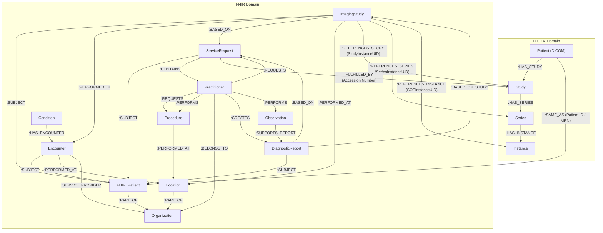

# FHIR Schema Design Notes

This document contains informal design notes for the FHIR graph schema.

## Introduction

This document provides an overview of the FHIR schema design, property encoding conventions, and resource layouts, along with the correlation model between DICOM entities and FHIR resources.

## Goals

### What This Is

This system is primarily a DICOM-based graph schema designed to support interoperability and efficient data exchange in healthcare applications.

Its purpose is to maintain and discover relationships between FHIR resources and DICOM data.

### What This Is Not

This system is not intended to be the system of record for FHIR-based data.

FHIR ingestion is strictly for value and relationship discovery. The authoritative FHIR data resides in the external FHIR system.

### Operational Context (DICOM-Driven FHIR Discovery)

The schema is designed around an event-driven workflow triggered by DICOM ingestion:

1. **DICOM Ingestion Trigger**: When a DICOM object is pushed to the server (via DIMSE `C-STORE` or DICOMweb `STOW-RS`), the DICOM hierarchy (`Patient` $\rightarrow$ `Study` $\rightarrow$ `Series` $\rightarrow$ `Instance`) is persisted in the graph. Key correlation identifiers—specifically **Patient ID** `(0010,0020)`, **Accession Number** `(0008,0050)`, and **Study Instance UID** `(0020,000D)`—are extracted from the DICOM dataset.
2. **Associated FHIR Resource Pull**: Using the `Patient ID` and `Accession Number`, the system queries the external FHIR server to pull and link associated clinical resources (such as `FHIR_Patient`, `Encounter`, `ServiceRequest`, `ImagingStudy`, `Condition`, `Observation`, `Practitioner`, `Location`, and `Organization`).
3. **Polling for `DiagnosticReport`**: Because radiology reports are generated asynchronously after image acquisition, the system periodically polls the external FHIR server (correlating by `Accession Number`, `ServiceRequest`, `ImagingStudy`, or `Patient ID`) until the corresponding `DiagnosticReport` (and any supporting `Observation` resources) appears and reaches a terminal state (e.g., `status = "final"`).

## Overall Schema



### Cross-Domain Correlation Keys (DICOM $\leftrightarrow$ FHIR)

To link incoming DICOM objects with external FHIR resources and support polling until a `DiagnosticReport` is available, the following correlation keys must be indexed and matched across domains:

| DICOM Attribute | Tag | DICOM Node Property | FHIR Target Resource & Property | Matching Mechanism |
| :--- | :--- | :--- | :--- | :--- |
| **Patient ID** | `(0010,0020)` | `Patient.patient_id` | `FHIR_Patient.identifiers` | Matches Identifier Macro entry `\|<patient_id>` or `<system>\|<patient_id>` (e.g., MRN). |
| **Accession Number** | `(0008,0050)` | `Study.accession_number` | `ServiceRequest.identifiers`<br/>`ImagingStudy.identifiers`<br/>`DiagnosticReport.identifiers` | Matches Identifier Macro entry `\|<accession_number>` where `identifierType` contains `http://terminology.hl7.org/CodeSystem/v2-0203\|ACSN\|Accession ID`. |
| **Study Instance UID** | `(0020,000D)` | `Study.study_instance_uid` | `ImagingStudy.identifiers` / `ImagingStudy.studyUid` | Matches `urn:dicom:uid\|urn:oid:<study_instance_uid>` or `\|<study_instance_uid>`. |
| **Series Instance UID** | `(0020,000E)` | `Series.series_instance_uid` | `ImagingStudy.seriesUid` | Exact string match against `series.uid` elements in `ImagingStudy`. |
| **SOP Instance UID** | `(0008,0018)` | `Instance.sop_instance_uid` | `ImagingStudy.instanceUid` | Exact string match against `series.instance.uid` elements in `ImagingStudy`. |

## Node Properties Layout

Cypher-based nodes store properties that can be queried for value matches. Unlike a document database, a graph database cannot directly index values within nested JSON structures.

This system does not support searching across arbitrary fields. For fields that must be searchable, nested FHIR structures are flattened into standardized string and array macros.

### The `resource` and `resourceUri` Properties

Each FHIR node contains nullable `resource` and `resourceUri` properties. At least one of these two properties must be non-null (they cannot both be null), though both may be populated simultaneously to support archived FHIR resources. Once ingested, these properties are considered immutable.

The raw FHIR payload is stored in either the `resource` property or the `resourceUri` property based on size:

- **4 KB or less**: If the ingested raw FHIR JSON is 4 KB or smaller, it is stored inline as a JSON string in `resource`.
- **Larger than 4 KB**: If the payload exceeds 4 KB, it is stored externally and referenced in `resourceUri`. The URI uses `file://` or cloud-storage schemes such as `s3://` or `gs://`.

> **Architectural Note:** Large payloads are not stored inline due to how Neo4j allocates and manages memory. Projecting large node property values into the active memory pool can degrade overall database performance.

### Flattening Complex Types as Strings (Macros)

#### Identifier Macro

Consider the following example of a FHIR `Identifier` array:

```json
{
  "identifier": [
    {
      "use": "official",
      "system": "https://github.com/synthetichealth/synthea",
      "value": "b86d32b0-5bd7-2bbd-c575-b07bfaa9270e"
    }
  ]
}
```

We canonicalize this structure into an array of strings using the `system|value` format (including partial combinations for flexible matching):

```json
{
  "identifiers": [
    "https://github.com/synthetichealth/synthea|b86d32b0-5bd7-2bbd-c575-b07bfaa9270e",
    "|b86d32b0-5bd7-2bbd-c575-b07bfaa9270e",
    "https://github.com/synthetichealth/synthea|"
  ]
}
```

Including the `"|value"` form allows the system to look up a `FHIR_Patient`, `ServiceRequest`, `ImagingStudy`, or `DiagnosticReport` using only a bare DICOM `PatientID` `(0010,0020)` or `AccessionNumber` `(0008,0050)` when the assigning authority/system URI is unknown at the time of DICOM ingestion.

We can then index the `identifiers` property with:

```cypher
CREATE INDEX fhir_patient_identifiers FOR (p:FHIR_Patient) ON (p.identifiers);
CREATE INDEX service_request_identifiers FOR (sr:ServiceRequest) ON (sr.identifiers);
CREATE INDEX imaging_study_identifiers FOR (is:ImagingStudy) ON (is.identifiers);
CREATE INDEX diagnostic_report_identifiers FOR (dr:DiagnosticReport) ON (dr.identifiers);
```

#### Coding Macro

FHIR `Coding` and `CodeableConcept` entries are flattened into strings using the format `"system|code|display"` (or `"system|code"` when `display` is absent), for example:
`"http://loinc.org|24606-6|MG Breast Screening"`

#### Coded Value Macro

Codes and values are frequently used in `Observation` and `DiagnosticReport` resources to describe clinical measurements or findings (for example, a blood pressure measurement or a diagnosis code).

Because Cypher disallows heterogeneous arrays—and FHIR sets no upper bound on the number of codes or values in `Observation` or `DiagnosticReport` resources—we use parallel arrays. Users also frequently query numeric values by range (e.g., normal or abnormal ranges) rather than by exact match.

We represent coded values using three parallel Cypher node properties—`codes`, `numericValues`, and `units`—synchronized by array index:

```json
{
  "codes": ["http://loinc.org|20565-8|Carbon dioxide, total [Moles/volume] in Blood"],
  "numericValues": [25.1],
  "units": ["http://unitsofmeasure.org|mmol/L|mmol/L"]
}
```

#### Reference Macro

FHIR `Reference` objects are flattened into the string format `"reference|display"`, for example:
`"Location/1237|A Medical Center"`

### Sub-Observations and Sub-Reports

Sub-observations and sub-reports use the same node structure as their parent resources and are linked from the primary resource via the `:CONTAINS` relationship.

## Proposed Resource Schema Layout

This version roughly follows the Pydantic models defined in `fhir.resources.R4B`. When FHIR R6 is released, we will make the necessary backward-compatible adjustments.

### Domain Resource (Base Fields)

All FHIR domain resources include the following base properties:

- `uid`: `string` — Internal unique ID, typically `ingestion-source:resource-id`, or any idempotent string.
- `id`: `string` — Resource ID from the source FHIR system.
- `status`: `string` — Resource status (e.g., `"active"`, `"cancelled"`, `"entered-in-error"`, `"final"`).
- `resource`: `string` (optional) — Inline raw FHIR JSON string (when payload is 4 KB or less).
- `resourceUri`: `string` (optional) — URI pointing to the external raw FHIR JSON file (`file://`, `s3://`, or `gs://`).

### FHIR_Patient

Uses the FHIR `Patient` resource schema. It is labeled `FHIR_Patient` to distinguish it from `Patient` nodes derived from DICOM studies.

- *(Inherits all Domain Resource fields)*
- `identifiers`: list of Identifier Macros — Used to correlate with DICOM `Patient.patient_id` `(0010,0020)`
- `identifierType`: list of Coding Macros (optional)
- `active`: `boolean` (optional)
- `name`: list of `string` (optional)
- `gender`: `string` (optional)
- `birthDate`: `string` / `date` (optional)
- `managingOrganization`: Reference Macro (optional)

### Encounter

- *(Inherits all Domain Resource fields)*
- `identifiers`: list of Identifier Macros
- `class`: Coding Macro (`system|code`)
- `type`: list of Coding Macros
- `subject`: Reference Macro
- `participantType`: list of Coding Macros (optional)
- `participantPeriodStart`: list of `datetime` (optional)
- `participantPeriodEnd`: list of `datetime` (optional)
- `participantIndividual`: list of Reference Macros (optional)
- `periodStart`: `datetime` (optional)
- `periodEnd`: `datetime` (optional)
- `location`: list of Reference Macros (optional)
- `serviceProvider`: Reference Macro (optional)

### Condition

- *(Inherits all Domain Resource fields)*
- `identifiers`: list of Identifier Macros (optional)
- `clinicalStatus`: list of Coding Macros
- `verificationStatus`: list of Coding Macros
- `category`: list of Coding Macros
- `code`: list of Coding Macros
- `subject`: Reference Macro
- `encounter`: Reference Macro (optional)
- `onsetDateTime`: `datetime` (optional)
- `abatementDateTime`: `datetime` (optional)
- `recordedDate`: `datetime` (optional)

### ImagingStudy

- *(Inherits all Domain Resource fields)*
- `identifiers`: list of Identifier Macros — Includes Accession Number and DICOM Study UID (`urn:dicom:uid`)
- `identifierType`: list of Coding Macros (optional)
- `identifierUse`: list of `string` (`Identifier.use` values) (optional)
- `subject`: Reference Macro
- `encounter`: Reference Macro (optional)
- `basedOn`: list of Reference Macros (optional) — References fulfilling `ServiceRequest` resources
- `started`: `datetime` (optional)
- `procedureCode`: list of Coding Macros (optional)
- `procedureCodeText`: `string` (optional)
- `location`: Reference Macro (optional)
- `studyUid`: `string` (optional) — Extracted DICOM `StudyInstanceUID` `(0020,000D)` for direct graph linking to `:Study`
- `seriesUid`: list of `string` (optional) — Extracted DICOM `SeriesInstanceUID` `(0020,000E)` values for linking to `:Series`
- `instanceUid`: list of `string` (optional) — Extracted DICOM `SOPInstanceUID` `(0008,0018)` values for linking to `:Instance`
- `seriesModality`: list of Coding Macros
- `bodySite`: list of Coding Macros (optional)
- `seriesStarted`: list of `datetime` (optional)

### Location

- *(Inherits all Domain Resource fields)*
- `identifiers`: list of Identifier Macros (optional)
- `identifierType`: list of Coding Macros (optional)
- `operationalStatus`: Coding Macro (optional)
- `name`: `string` (optional)
- `alias`: list of `string` (optional)
- `description`: `string` (optional)
- `mode`: `string` (optional) — `"instance"` or `"kind"`
- `type`: list of Coding Macros (optional) — Function performed at the location (e.g., radiology unit, CT suite)
- `physicalType`: Coding Macro (optional) — Physical form of the location (e.g., building, wing, room)
- `telecom`: list of `string` (`system|value|use`) (optional)
- `address`: `string` (optional)
- `managingOrganization`: Reference Macro (optional) — References the responsible `Organization` (supports `:PART_OF` relationship to `Organization`)
- `partOf`: Reference Macro (optional) — References a parent `Location`

### Observation

- *(Inherits all Domain Resource fields)*
- `identifiers`: list of Identifier Macros (optional)
- `basedOn`: list of Reference Macros (optional)
- `encounter`: Reference Macro (optional)
- `code`: list of Coding Macros
- `subject`: Reference Macro
- `performer`: list of Reference Macros (optional)
- `valueQuantity`: Coded Value Macro (`codes`, `numericValues`, `units`) (optional)
- `bodySite`: list of Coding Macros (optional)
- `text`: `string` (optional)

### Organization

- *(Inherits all Domain Resource fields; `status` is optional as FHIR `Organization` uses `active`)*
- `identifiers`: list of Identifier Macros (optional) — Includes NPI, facility IDs, or OIDs
- `identifierType`: list of Coding Macros (optional)
- `active`: `boolean` (optional)
- `type`: list of Coding Macros (optional) — Organization category (e.g., healthcare provider, hospital department)
- `name`: `string` (optional)
- `alias`: list of `string` (optional)
- `telecom`: list of `string` (`system|value|use`) (optional)
- `address`: list of `string` (optional)
- `partOf`: Reference Macro (optional) — References a parent `Organization`

### DiagnosticReport

- *(Inherits all Domain Resource fields)*
- `identifiers`: list of Identifier Macros (optional) — May include Accession Number (`ACSN`)
- `identifierType`: list of Coding Macros (optional)
- `basedOn`: list of Reference Macros (optional) — References `ServiceRequest` (primary link from an order/accession to its report)
- `imagingStudy`: list of Reference Macros (optional) — References `ImagingStudy` associated with the acquired DICOM study
- `category`: list of Coding Macros (optional)
- `code`: list of Coding Macros
- `subject`: Reference Macro
- `encounter`: Reference Macro (optional)
- `effectiveDateTime`: `datetime` (optional)
- `issued`: `datetime` (optional)
- `performer`: list of Reference Macros (optional)
- `result`: list of Reference Macros (optional) — References supporting `Observation` resources
- `conclusion`: `string` (optional)
- `textStatus`: `string` (optional)
- `textDiv`: `string` (optional)
- `presentedFormData`: list of `string` (optional) — Base64-encoded attachment data when present

### Practitioner

- *(Inherits all Domain Resource fields; `status` is optional as FHIR `Practitioner` uses `active`)*
- `identifiers`: list of Identifier Macros (optional) — Includes NPI (`http://hl7.org/fhir/sid/us-npi`), state license, or internal provider ID
- `identifierType`: list of Coding Macros (optional)
- `active`: `boolean` (optional)
- `name`: list of `string` (optional) — Formatted human-readable name(s) (e.g., `"Dr. Sarah Lin, MD"`)
- `telecom`: list of `string` (`system|value|use`) (optional)
- `address`: list of `string` (optional)
- `gender`: `string` (optional)
- `birthDate`: `string` / `date` (optional)
- `qualificationCode`: list of Coding Macros (optional) — Flattened from `qualification[].code` (e.g., MD, DO, board certifications)
- `qualificationIssuer`: list of Reference Macros (optional) — Flattened from `qualification[].issuer` (`Organization`)
- `communication`: list of Coding Macros (optional)
- `organization`: list of Reference Macros (optional) — Associated `Organization`(s) (e.g., resolved via `PractitionerRole.organization`, supporting the `:BELONGS_TO` relationship)
- `specialty`: list of Coding Macros (optional) — Clinical specialty (e.g., Radiology, Pulmonology, resolved via `PractitionerRole.specialty`)

### ServiceRequest

- *(Inherits all Domain Resource fields)*
- `identifiers`: list of Identifier Macros (`type` field is omitted here and stored in `identifierType`; includes Accession Number `ACSN` and Placer Order `PLAC`)
- `identifierType`: list of Coding Macros (optional)
- `intent`: `string`
- `category`: list of Coding Macros (optional)
- `priority`: `string` (optional)
- `code`: list of Coding Macros
- `codeText`: `string` (optional)
- `subject`: Reference Macro
- `encounter`: Reference Macro (optional)
- `occurrenceDateTime`: `datetime` (optional)
- `authoredOn`: `datetime` (optional)
- `requester`: Reference Macro (optional)
- `reasonCode`: list of Coding Macros (optional)
- `bodySite`: list of Coding Macros (optional)
- `bodySiteText`: `string` (optional)
- `patientInstruction`: `string` (optional)
- `supportingInfo`: list of Reference Macros (optional)

## Example FHIR Data

### DiagnosticReport

```json
{
  "resourceType": "DiagnosticReport",
  "id": "dx-report-radiology",
  "status": "final",
  "basedOn": [
    {
      "reference": "ServiceRequest/sr-ct-chest-contrast-001"
    }
  ],
  "imagingStudy": [
    {
      "reference": "ImagingStudy/is-ct-chest-001"
    }
  ],
  "code": {
    "coding": [
      {
        "system": "http://loinc.org",
        "code": "24606-6",
        "display": "MG Breast Screening"
      }
    ]
  },
  "subject": {
    "reference": "Patient/pat-10492"
  },
  "text": {
    "status": "generated",
    "div": "<div xmlns=\"http://www.w3.org/1999/xhtml\"><h3>Findings</h3><p>No acute abnormalities identified. Breast density is BI-RADS category B.</p></div>"
  },
  "conclusion": "BI-RADS Category 1 - Negative. Routine annual screening recommended.",
  "presentedForm": [
    {
      "contentType": "application/pdf",
      "url": "Binary/dx-pdf-001",
      "title": "Diagnostic Report (PDF)"
    },
    {
      "contentType": "text/plain",
      "data": "RklORElOR1M6IE5vIGFjdXRlIGFibm9ybWFsaXRpZXMgaWRlbnRpZmllZC4=",
      "title": "Raw Transcription Text"
    }
  ]
}
```

### ServiceRequest

```json
{
  "resourceType": "ServiceRequest",
  "id": "sr-ct-chest-contrast-001",
  "identifier": [
    {
      "type": {
        "coding": [
          {
            "system": "http://terminology.hl7.org/CodeSystem/v2-0203",
            "code": "PLAC",
            "display": "Placer Identifier"
          }
        ]
      },
      "system": "http://hospital.example.org/orders",
      "value": "ORD-20261029-88102"
    },
    {
      "type": {
        "coding": [
          {
            "system": "http://terminology.hl7.org/CodeSystem/v2-0203",
            "code": "ACSN",
            "display": "Accession ID"
          }
        ]
      },
      "system": "http://radiology.example.org/accession",
      "value": "ACC-9948271"
    }
  ],
  "status": "active",
  "intent": "order",
  "category": [
    {
      "coding": [
        {
          "system": "http://snomed.info/sct",
          "code": "363679005",
          "display": "Imaging"
        }
      ]
    }
  ],
  "priority": "routine",
  "code": {
    "coding": [
      {
        "system": "http://loinc.org",
        "code": "24627-2",
        "display": "CT Chest W contrast IV"
      },
      {
        "system": "http://www.ama-assn.org/go/cpt",
        "code": "71260",
        "display": "Computed tomography, thorax; with contrast material(s)"
      }
    ],
    "text": "CT Chest with IV Contrast"
  },
  "subject": {
    "reference": "Patient/pat-10492",
    "display": "Jane Doe"
  },
  "encounter": {
    "reference": "Encounter/enc-44821"
  },
  "occurrenceDateTime": "2026-10-30T09:30:00-07:00",
  "authoredOn": "2026-10-29T17:45:00-07:00",
  "requester": {
    "reference": "Practitioner/dr-pulmonologist-12",
    "display": "Dr. Sarah Lin, MD"
  },
  "reasonCode": [
    {
      "coding": [
        {
          "system": "http://hl7.org/fhir/sid/icd-10-cm",
          "code": "R91.1",
          "display": "Solitary pulmonary nodule"
        }
      ],
      "text": "Solitary pulmonary nodule follow-up"
    }
  ],
  "bodySite": [
    {
      "coding": [
        {
          "system": "http://snomed.info/sct",
          "code": "51185008",
          "display": "Thoracic structure"
        }
      ],
      "text": "Chest"
    }
  ],
  "patientInstruction": "Patient must have IV access established. NPO 4 hours prior if possible.",
  "supportingInfo": [
    {
      "reference": "Observation/serum-creatinine-recent",
      "display": "Serum Creatinine & eGFR (contrast clearance)"
    }
  ]
}
```
