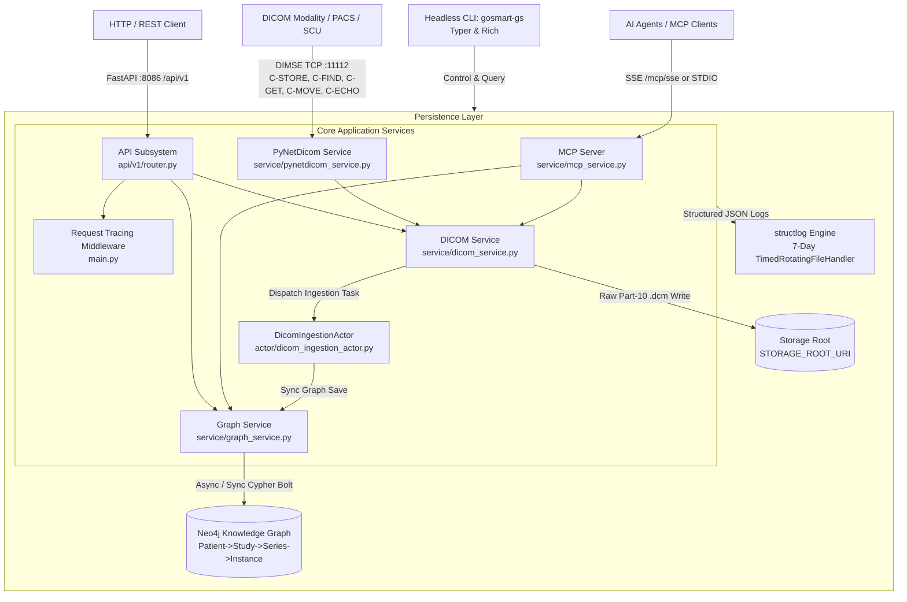
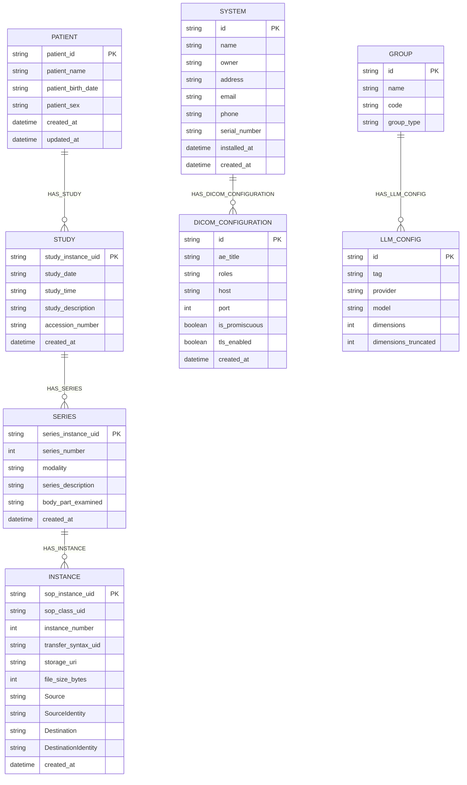

# System Design Specification (SDS) / Software Architecture Description

**Document ID:** SDS-GSGS-001  
**Project:** `gosmart-graphite`  
**Regulatory Standard Alignment:** IEC 62304 Clause 5.3 / 5.4, FDA 21 CFR 820.30, ISO 13485:2016 Clause 7.3  

---

## 1. Executive Summary & Architectural Scope

`gosmart-graphite` is a graph-native, headless **Vendor Neutral Archive (VNA)** and medical imaging knowledge engine. Built on **Python 3.14**, **FastAPI**, **Pydantic**, **Neo4j**, **pydicom**, **pynetdicom**, **Pykka**, and **Model Context Protocol (MCP)**, the software provides:
1. Full DICOM Upper Layer network communication (DIMSE: C-STORE, C-FIND, C-GET, C-MOVE, C-ECHO).
2. Deep graph-topological persistence in Neo4j capturing the hierarchical clinical relationships (`Patient -> Study -> Series -> Instance`) and cross-study query topologies.
3. Concurrent, non-blocking ingestion and graph indexing via Pykka actors.
4. Embedded Model Context Protocol (MCP) server over Server-Sent Events (SSE).
5. Headless terminal management via the `gosmart-graphite` CLI (with zero dependency on client web UIs).
6. Industrial-strength structured logging via `structlog` with arbitrary JSON values and 7-day auto-rotating file handlers.

---

## 2. System Subsystem Architecture

---

## 3. Subsystem Decomposition & Contracts

### 3.1 Core Subsystem (`core/`)
* **`config.py`**: Pydantic Settings implementation enforcing the `GOSMART_GS_` environment variable prefix:
  - `DB_CONNECTION_URI`, `DB_USER`, `DB_PASSWORD`, `DB_DATABASE`, `DB_CONNECT_RETRY_TIMEOUT_SEC`, `DB_CONNECT_RETRY_INITIAL_DELAY_SEC`, `DB_CONNECT_RETRY_MAX_DELAY_SEC`
  - `STORAGE_ROOT_URI`
  - `DEV_MODE`, `HOST`, `PORT`, `RELOAD`
  - `LOG_LEVEL`, `LOG_FORMAT`, `LOG_DIR`, `LOG_FILE`, `LOG_ROTATION_DAYS`, `LOG_BACKUP_COUNT`, `LOG_TO_FILE`
  - `DICOM_AE_TITLE`, `DICOM_SCP_PORT`, `DICOM_MAX_PDU`
  - `LLM_CONFIG_ENCRYPTION_KEY`: Optional Fernet key or passphrase for encrypting stored `LLM_Config` `api_key` values at rest in Neo4j
* **`security.py`**: Password hashing (Argon2id), JWT signing/decoding, API key hashing, and `LLM_Config` secret utilities (`is_env_var_reference`, `classify_llm_api_key`, `encrypt_llm_api_key`, `resolve_llm_api_key`, `mask_llm_api_key`).
* **`auth_dependency.py`**: FastAPI dependencies (`get_current_user`, `get_current_group_context`, `require_roles`) plus `ContextVar` active group propagation (`get_active_group_id`, `set_active_group_id`, `reset_active_group_id`).
* **`logging.py`**: Industrial-strength `structlog` logging engine:
  - Dual output: Console (`JSONRenderer` or `ConsoleRenderer`) and File (`TimedRotatingFileHandler` with `JSONRenderer`).
  - 7-day auto-rotation (`when="D", interval=7`) with backup retention (`backupCount=8`).
  - Contextvars tracing via `bind_log_context()` and `clear_log_context()`.
  - ProcessorFormatter integration routing standard library loggers (`uvicorn`, `fastapi`, `neo4j`, `pydicom`, `pynetdicom`, `pykka`).

### 3.2 Database Subsystem (`db/`)
* **`neo4j.py`**: Manages Neo4j driver lifecycles and transactions:
  - Async driver (`AsyncGraphDatabase.driver`) for FastAPI and MCP coroutines.
  - Synchronous driver (`GraphDatabase.driver`) for Pykka threading actors.
  - Managed explicit write transactions (`execute_write_tx`, `execute_write_tx_sync`) guaranteeing atomic relationship swaps and retries.
  - Connection pooling and verification (`verify_connectivity`).
* **`schema_loader.py` & Consolidated `.cypher` Schema Scripts**:
  - Schema DDL is consolidated into five focused `.cypher` files loaded in deterministic order from an explicit, immutable allowlist (`SCHEMA_SCRIPT_FILES`) rather than directory scanning to prevent arbitrary Cypher script injection:
    - `system_schema.cypher`: `System`, `User`, `Identity`, `Authenticator`, `Group`, and `AuditLog` uniqueness constraints plus `BELONGS_TO` / `NOT_BELONGS_TO` relationship indexes.
    - `config_schema.cypher`: `DICOMConfiguration`, `FHIRConfiguration`, and `LLM_Config` constraints/indexes (`llm_config_tag_idx`) plus configuration association relationship indexes (`HAS_LLM_CONFIG`, `HAS_FHIR_CONFIG`, `HAS_DICOM_CONFIGURATION`, `SERVES`, and `NOT_*` counterparts).
    - `dicom_schema.cypher`: Deterministic `id` and DICOM UID uniqueness constraints for `Patient`, `Study`, `Series`, and `Instance`.
    - `fhir_schema.cypher`: FHIR R4B resource uniqueness constraints, property indexes, and cross-domain `Study.accession_number` index.
    - `embedding_schema.cypher`: `:Embedding` uniqueness constraint (`id`), property indexes (`test_id`, `modelTag`, `targetFieldTag`), relationship indexes (`EMBEDS`, `NOT_EMBEDS`), and 768-dimension cosine `CREATE VECTOR INDEX` (`embedding_vector_idx` on `(:Embedding).vector`).
  - **Fail-fast & Triage Semantics**: Missing manifest scripts, lexical/parse errors, or Cypher execution errors raise a non-negotiable `SchemaInitializationError` logging the exact script filename, 1-based line number(s) (including Neo4j column offsets when available), failing statement, and underlying database error, aborting startup.
  - **Startup Connectivity Policy (`GOSMART_GS_DEV_MODE`)**: In production (`DEV_MODE=false`), `GraphService.init_schema_constraints()` automatically retries Neo4j connectivity with capped exponential backoff (`GOSMART_GS_DB_CONNECT_RETRY_TIMEOUT_SEC`, default `600s`; `0` = indefinite) to ride out transient cloud outages or upgrades before raising `SchemaInitializationError`. Setting `GOSMART_GS_DEV_MODE=true` relaxes offline Neo4j connectivity during local development.

### 3.3 Data Models Subsystem (`model/`)
* **`auditable.py`**: Auditable base entities, deterministic ID derivation, and relation negation helpers:
  - `generate_deterministic_id()`: Computes deterministic UUIDv5 from canonical JSON-serialized identity subsets.
  - `Auditable`: Base model providing `id`, `test_id`, `Action` (`CREATE`, `UPDATE`, `DELETE`, `RESTORE`), `ActedAt`, `ActedBy`, `CreatedAt`, `UpdatedAt`, and `ExpiresAt` (all timestamps Cypher `datetime({timezone: 'UTC'})`).
  - `AuditableNode`: Base node with single static class label enforcement (`__label__`).
  - `AuditableRelation`: Base relationship with single static class type enforcement (`__type__`) and reserved `NOT_` negation semantics.
  - Relation negation helpers: `to_negated_relation_type()`, `to_positive_relation_type()`, `is_negated_relation_type()`.
* **`dicom_config.py`**: DICOM protocol configuration graph models and API DTOs:
  - `DICOMConfigurationNode` (`:DICOMConfiguration`) and `HasDicomConfigurationRelation` (`HAS_DICOM_CONFIGURATION`): DIMSE/DICOMweb parameters, TLS security settings, services, transfer syntaxes, default `storage_root_uri`, and promiscuous mode support.
  - `DICOMConfigurationGroupSummary`, `DICOMConfigurationResponse`, `DICOMConfigurationCreateRequest`, `DICOMConfigurationUpdateRequest`: Request/response DTOs for DICOM configuration CRUD.
* **`graph.py`**: Concrete graph domain models and generic query models:
  - Concrete Nodes: `PatientNode` (`:Patient`), `StudyNode` (`:Study`), `SeriesNode` (`:Series`), `InstanceNode` (`:Instance`), `SystemNode` (`:System`), `FHIRConfigurationNode` (`:FHIRConfiguration`), `TransferStatusNode` (`:TransferStatus`).
  - Concrete Relationships: `HasStudyRelation` (`HAS_STUDY`), `HasSeriesRelation` (`HAS_SERIES`), `HasInstanceRelation` (`HAS_INSTANCE`).
  - Generic query models: `CypherQueryRequest`, `GraphNode`, `GraphRelationship`, `GraphQueryResult`.
* **`system.py`**: Pydantic DTO models for system metadata and lifecycle operations:
  - `SystemResponse`, `SystemUpdateRequest`: Root environment metadata with owner contact information and serial numbers.
  - `SystemBootstrapResponse`, `TestCleanupResponse`: Idempotent environment initialization and test cleanup status.
* **`llm.py`**: Dynamic, group-scoped LLM configuration models:
  - `LLM_Config` (`LLMConfigNode`, `__label__ = "LLM_Config"`): Auditable node capturing `tag` (globally unique purpose key), normalized `provider`, `model`, `url`, `dimensions`, `dimensions_truncated` (validated `<= dimensions`), `api_key`, `location`, `project_id`, `extra_config`, and `description`.
  - `HasLlmConfigRelation` (`__type__ = "HAS_LLM_CONFIG"`): Links sponsoring `(:Group)` to `(:LLM_Config)`.
  - API/CLI DTOs: `LLMConfigCreateRequest`, `LLMConfigUpdateRequest`, `LLMConfigAssignRequest`, `LLMConfigGroupSummary`, `LLMConfigResponse` (always masks `api_key` and exposes `has_api_key` and `api_key_source`).
* **`embedding.py`**: Decoupled vector embedding graph models:
  - `Embedding` (`EmbeddingNode`, `__label__ = "Embedding"`): Auditable node storing `modelTag` (e.g., `LLM_Config.tag`), `size` (auto-validated vector length), `vector` (L2-normalized float array indexed by `embedding_vector_idx`), and `targetFieldTag` (e.g., `FINDINGS`, `CONCLUSION`) with target-scoped deterministic UUIDv5 `id` generation.
  - `EmbedsRelation` (`__type__ = "EMBEDS"`): Auditable relationship linking `(:Embedding)-[:EMBEDS {aspect}]->(target domain node)`.
  - `DiagnosticReportFieldTag` (`StrEnum`): Canonical field/aspect tags (`FINDINGS`, `CONCLUSION`) for `DiagnosticReport` embeddings.
* **`dicom.py`**: Pydantic models for domain entities:
  - `PatientModel`: `patient_id`, `patient_name`, `patient_birth_date`, `patient_sex`
  - `StudyModel`: `study_instance_uid`, `study_date`, `study_time`, `study_description`, `accession_number`
  - `SeriesModel`: `series_instance_uid`, `series_number`, `modality`, `series_description`, `body_part_examined`
  - `InstanceModel`: `sop_instance_uid`, `sop_class_uid`, `instance_number`, `transfer_syntax_uid`, `storage_uri`, `file_size_bytes`
  - `DicomHierarchy`: Composite clinical hierarchy model with `test_id`, `acted_by`, `expires_at`, and conversion helpers `to_nodes()` / `to_relations()`.
* **`media.py`**: Storage domain models (`StorageScheme`, `ParsedStorageUri`, `MediaMetadata`).
* **`health.py`**: Health models (`ServiceHealth`, `HealthResponse`).

### 3.4 Services Subsystem (`service/`)
* **`system_service.py`**:
  - `bootstrap_system()`: Ensures the root `System` node exists with default organizational placeholders and connects the primary promiscuous DICOM configuration (`ae_title="*"`) matching `config.py`.
  - `cleanup_all_test_data()`: Full test cleanup routine across property graph labels (`System`, `DICOMConfiguration`, `Instance`, `Patient`, `Series`, `Study`) where `test_id` is defined and non-empty. Drains associated ephemeral test SCP instances and detaches/deletes nodes with label breakdown.
  - Manages full CRUD operations for `System` and `DICOMConfiguration` nodes.
  - Handles relationship soft-deletion (`NOT_HAS_DICOM_CONFIGURATION`) and restoration (`HAS_DICOM_CONFIGURATION`).
* **`llm_config_service.py`**:
  - Async and `_sync` Neo4j persistence for `(:LLM_Config)` nodes and `(:Group)-[:HAS_LLM_CONFIG]->(:LLM_Config)` links.
  - `resolve_target_group()`: Matches active `Group` by `id`, `name`, or `code` (defaults to `'GoSmart Health'`; fails on 0 or `>1` matches).
  - `upsert_llm_config()`: Overwrite clones prior canonical state to `<id>__archived__<hex>` (`Action='DELETE'`) with `[:NOT_HAS_LLM_CONFIG]` links on previously linked groups while preserving active `[:HAS_LLM_CONFIG]` links across all sponsoring groups.
  - `resolve_config_for_group()` / `resolve_config_for_group_sync()`: Upward `(:Group)-[:BELONGS_TO*0..]->(:Group)` shortest-path resolution with `'GoSmart Health'` fallback; raises on same-depth ambiguity.
* **`embedding_service.py`**:
  - `EmbeddingService` (aliased as `VectorService`) dynamically resolves active `LLM_Config` (default `tag='embedding-v1'`) for the active `Group` (`ContextVar` or explicit `group_id`).
  - Maintains a thread-safe Genkit client cache keyed by resolved config fingerprint (`provider`, `url`, resolved `api_key`, `location`, `project_id`).
  - Supports `dimensions` (e.g., `output_dimensionality`) and Matryoshka `dimensions_truncated` post-truncation with L2 vector normalization and similarity scoring.
* **`media_service.py`**:
  - Storage-agnostic media service implementing unified read, write, exists, delete, stat, list_files, copy, move, and DICOM dataset read/write.
  - Multi-provider URI support: Local files (`file://`), Windows UNC (`\\server\share`), Google Cloud Storage (`gs://`), Amazon S3 (`s3://`), and Azure Blob (`az://` or `azure://`).
  - Standard SDK environment credential auto-discovery (GCP, AWS, Azure).
  - Fully asynchronous core methods (`async def`) with thread-safe `run_sync()` execution helpers for Pykka actors and main thread callers.
* **`dicom_service.py`**:
  - `parse_dataset()` / `parse_file()`: Parses DICOM header into `DicomHierarchy`.
  - `save_raw_dicom()`: Persists binary files into `STORAGE_ROOT_URI/{sop_uid}.dcm` using `media_service`.
  - `create_mock_dicom()`: Synthesizes valid in-memory FileDataset for automated testing.
* **`graph_service.py`**:
  - Executes merge Cypher queries to persist DICOM hierarchy in Neo4j with full audit tracking.
  - Atomically swaps relationships under explicit write transactions (`soft_delete_relationship` cloning properties to `NOT_<rel_type>`, and `restore_relationship`).
  - Node soft-deletion and restoration (`soft_delete_node`, `restore_node`).
  - Pre-test cleanup routine (`cleanup_test_data`) isolating ephemeral test entities.
  - Query methods: `list_patients()`, `get_patient_graph()`, `execute_custom_query()` with test isolation and deletion filtering.
* **`pynetdicom_service.py`**:
  - Manages dynamic multi-SCP server instances (`SCPInstance`) based on active `(:DICOMConfiguration)` nodes in Neo4j.
  - Implements dynamic lifecycle transitions:
    - **Added**: Instantiates and launches new SCP instances bound to configured host, port, and AE title.
    - **Changed**: Drains active association threads on old instance while launching new SCP with updated configuration.
    - **Removed**: Drains active associations until completion before fully stopping.
  - Strictly negotiates and honors configured `dicom_services` (SOP Classes) and `transfer_syntaxes` during association negotiation.
  - Provides C-ECHO verification SCU and C-STORE Part-10 blackbox recording.
* **`dicomweb_service.py`**:
  - Implements DICOMweb (PS 3.18) operations backed by Neo4j Knowledge Graph.
  - QIDO-RS: Fast query engine for Studies, Series, and Instances directly from graph node properties, computing live series/instance counts and modalities via relationship traversal.
  - WADO-RS: Single instance Part-10 file retrieval and multipart/related bulk retrieval for studies and series by resolving `storage_uri` via `media_service`.
  - STOW-RS: Ingestion endpoint supporting raw binary and `multipart/related` payloads with blackbox persistence and instance provenance tracking.
* **`mcp_service.py`**:
  - Exposes administrative and diagnostic MCP tools: `health_check`, `generate_mock_dicom`, `ingest_dicom_file`, `list_patients`, `get_patient_graph`, `soft_delete_relationship`, `restore_relationship`, `execute_cypher`, `echo_scu`, `get_system_info`, `update_system_info`, `bootstrap_system_defaults`, `list_dicom_configurations`, `get_dicom_configuration`, `create_dicom_configuration`, `update_dicom_configuration`, `delete_dicom_configuration`, `restore_dicom_configuration`, `list_llm_configurations`, `get_llm_configuration`, `upsert_llm_configuration`, `assign_llm_configuration_to_group`, `dissociate_llm_configuration_from_group`, `delete_llm_configuration`, `restore_llm_configuration`.

### 3.5 Actor Subsystem (`actor/`)
* **`dicom_ingestion_actor.py`**:
  - `DicomIngestionActor`: Subclasses `pykka.ThreadingActor` to process ingestion tasks asynchronously in a background worker thread.
  - Handles messages: `PING`, `INGEST_FILE`, `INGEST_MOCK`.
  - Maintains processed counters and execution status.

### 3.6 API Subsystem (`api/`) & CLI (`cli.py`)
* **`main.py`**:
  - FastAPI application factory with lifespan managing driver startup and shutdown.
  - Mounts MCP SSE server at `/mcp`.
  - HTTP middleware binding request ID and timing to structlog context.
* **`api/v1/endpoints/llm.py`**:
  - REST endpoints under `/api/v1/configurations/llm` (`GET`, `POST`, `GET /{config_id}`, `PUT /{config_id}`, `POST /{config_id}/assign`, `DELETE /{config_id}/groups/{group_id}`, `DELETE /{config_id}`, `POST /{config_id}/restore`) enforcing `PLATFORM_ADMIN`/`Admin` roles on mutations and masking `api_key`.
* **`cli.py` & `cli/configure.py`**:
  - Typer CLI (`gosmart-graphite`) providing terminal management: `start`, `health`, `mock`, `ingest`, `patients`, `query`, `echo`, `mcp`, `admin`, and `configure llm-config`.

---

## 4. Neo4j Knowledge Graph Data Model

