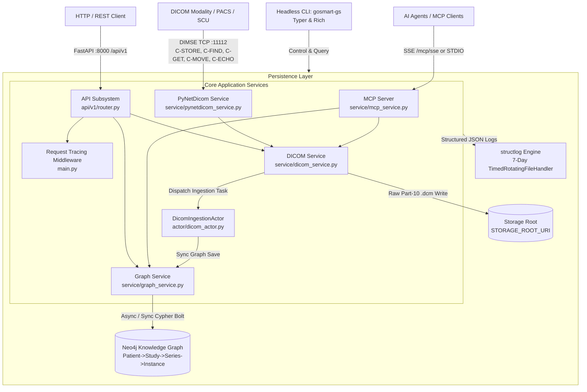
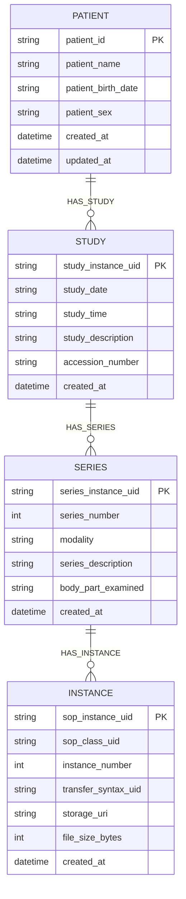

# System Design Specification (SDS) / Software Architecture Description

**Document ID:** SDS-GSGS-001  
**Project:** `gosmart-dicom-py-graph-server`  
**Regulatory Standard Alignment:** IEC 62304 Clause 5.3 / 5.4, FDA 21 CFR 820.30, ISO 13485:2016 Clause 7.3  

---

## 1. Executive Summary & Architectural Scope

`gosmart-dicom-py-graph-server` is a graph-native, headless **Vendor Neutral Archive (VNA)** and medical imaging knowledge engine. Built on **Python 3.14**, **FastAPI**, **Pydantic**, **Neo4j**, **pydicom**, **pynetdicom**, **Pykka**, and **Model Context Protocol (MCP)**, the software provides:
1. Full DICOM Upper Layer network communication (DIMSE: C-STORE, C-FIND, C-GET, C-MOVE, C-ECHO).
2. Deep graph-topological persistence in Neo4j capturing the hierarchical clinical relationships (`Patient -> Study -> Series -> Instance`) and cross-study query topologies.
3. Concurrent, non-blocking ingestion and graph indexing via Pykka actors.
4. Embedded Model Context Protocol (MCP) server over Server-Sent Events (SSE).
5. Headless terminal management via the `gosmart-gs` CLI (with zero dependency on client web UIs).
6. Industrial-strength structured logging via `structlog` with arbitrary JSON values and 7-day auto-rotating file handlers.

---

## 2. System Subsystem Architecture

---

## 3. Subsystem Decomposition & Contracts

### 3.1 Core Subsystem (`core/`)
* **`config.py`**: Pydantic Settings implementation enforcing the `GOSMART_GS_` environment variable prefix:
  - `DB_CONNECTION_URI`, `DB_USER`, `DB_PASSWORD`, `DB_DATABASE`
  - `STORAGE_ROOT_URI`
  - `HOST`, `PORT`, `RELOAD`
  - `LOG_LEVEL`, `LOG_FORMAT`, `LOG_DIR`, `LOG_FILE`, `LOG_ROTATION_DAYS`, `LOG_BACKUP_COUNT`, `LOG_TO_FILE`
  - `DICOM_AE_TITLE`, `DICOM_SCP_PORT`, `DICOM_MAX_PDU`
* **`logging.py`**: Industrial-strength `structlog` logging engine:
  - Dual output: Console (`JSONRenderer` or `ConsoleRenderer`) and File (`TimedRotatingFileHandler` with `JSONRenderer`).
  - 7-day auto-rotation (`when="D", interval=7`) with backup retention (`backupCount=8`).
  - Contextvars tracing via `bind_log_context()` and `clear_log_context()`.
  - ProcessorFormatter integration routing standard library loggers (`uvicorn`, `fastapi`, `neo4j`, `pydicom`, `pynetdicom`, `pykka`).

### 3.2 Database Subsystem (`db/`)
* **`neo4j.py`**: Manages Neo4j driver lifecycles and transactions:
  - Async driver (`AsyncGraphDatabase.driver`) for FastAPI and MCP coroutines.
  - Synchronous driver (`GraphDatabase.driver`) for Pykka threading actors.
  - Managed explicit write transactions (`execute_write_tx`, `execute_write_tx_sync`) guaranteeing atomic relationship swaps and retries.
  - Connection pooling and verification (`verify_connectivity`).
  - Schema constraint initialization:
    - Deterministic ID uniqueness: `Patient.id`, `Study.id`, `Series.id`, `Instance.id IS UNIQUE`
    - DICOM natural key uniqueness: `Patient.patient_id`, `Study.study_instance_uid`, `Series.series_instance_uid`, `Instance.sop_instance_uid IS UNIQUE`

### 3.3 Data Models Subsystem (`model/`)
* **`graph.py`**: Graph domain, auditable base entities, and query models:
  - `generate_deterministic_id()`: Computes deterministic UUIDv5 from canonical JSON-serialized identity subsets.
  - `Auditable`: Base model providing `id`, `test_id`, `Action` (`CREATE`, `UPDATE`, `DELETE`, `RESTORE`), `ActedAt`, `ActedBy`, `CreatedAt`, `UpdatedAt`, and `ExpiresAt` (all timestamps Cypher `datetime({timezone: 'UTC'})`).
  - `AuditableNode`: Base node with single static class label enforcement (`__label__`).
  - `AuditableRelation`: Base relationship with single static class type enforcement (`__type__`) and reserved `NOT_` negation semantics.
  - Concrete Nodes: `PatientNode` (`:Patient`), `StudyNode` (`:Study`), `SeriesNode` (`:Series`), `InstanceNode` (`:Instance`).
  - Concrete Relationships: `HasStudyRelation` (`HAS_STUDY`), `HasSeriesRelation` (`HAS_SERIES`), `HasInstanceRelation` (`HAS_INSTANCE`).
  - Generic query models: `CypherQueryRequest`, `GraphNode`, `GraphRelationship`, `GraphQueryResult`.
* **`dicom.py`**: Pydantic models for domain entities:
  - `PatientModel`: `patient_id`, `patient_name`, `patient_birth_date`, `patient_sex`
  - `StudyModel`: `study_instance_uid`, `study_date`, `study_time`, `study_description`, `accession_number`
  - `SeriesModel`: `series_instance_uid`, `series_number`, `modality`, `series_description`, `body_part_examined`
  - `InstanceModel`: `sop_instance_uid`, `sop_class_uid`, `instance_number`, `transfer_syntax_uid`, `storage_uri`, `file_size_bytes`
  - `DicomHierarchy`: Composite clinical hierarchy model with `test_id`, `acted_by`, `expires_at`, and conversion helpers `to_nodes()` / `to_relations()`.
* **`media.py`**: Storage domain models (`StorageScheme`, `ParsedStorageUri`, `MediaMetadata`).
* **`health.py`**: Health models (`ServiceHealth`, `HealthResponse`).

### 3.4 Services Subsystem (`service/`)
* **`media_service.py`**:
  - Storage-agnostic media service implementing unified read, write, exists, delete, stat, list_files, copy, move, and DICOM dataset read/write.
  - Multi-provider URI support: Local files (`file://`), Windows UNC (`\\server\share`), Google Cloud Storage (`gs://`), Amazon S3 (`s3://`), and Azure Blob (`az://` or `azure://`).
  - Standard SDK environment credential auto-discovery (GCP, AWS, Azure).
  - Fully asynchronous core methods (`async def`) with thread-safe `run_sync()` execution helpers for Pykka actors and main thread callers.
* **`dicom_service.py`**:
  - `parse_dataset()` / `parse_file()`: Parses DICOM header into `DicomHierarchy`.
  - `save_raw_dicom()`: Persists binary files into `STORAGE_ROOT_URI/{sop_uid}.dcm` using `media_service`.
  - `create_mock_dicom()`: Synthesizes valid in-memory FileDataset for automated testing.
* **`graph_service.py`**:
  - Executes merge Cypher queries to persist DICOM hierarchy in Neo4j with full audit tracking.
  - Atomically swaps relationships under explicit write transactions (`soft_delete_relationship` cloning properties to `NOT_<rel_type>`, and `restore_relationship`).
  - Node soft-deletion and restoration (`soft_delete_node`, `restore_node`).
  - Pre-test cleanup routine (`cleanup_test_data`) isolating ephemeral test entities.
  - Query methods: `list_patients()`, `get_patient_graph()`, `execute_custom_query()` with test isolation and deletion filtering.
* **`pynetdicom_service.py`**:
  - Configures Application Entity (`GOSMART_GS`) with presentation contexts for C-STORE, C-FIND, C-GET, C-MOVE, and C-ECHO.
  - Handles C-ECHO SCU ping execution.
* **`mcp_service.py`**:
  - Exposes 9 tools: `health_check`, `generate_mock_dicom`, `ingest_dicom_file`, `list_patients`, `get_patient_graph`, `soft_delete_relationship`, `restore_relationship`, `execute_cypher`, `echo_scu`.

### 3.5 Actor Subsystem (`actor/`)
* **`dicom_actor.py`**:
  - `DicomIngestionActor`: Subclasses `pykka.ThreadingActor` to process ingestion tasks asynchronously in a background worker thread.
  - Handles messages: `PING`, `INGEST_FILE`, `INGEST_MOCK`.
  - Maintains processed counters and execution status.

### 3.6 API Subsystem (`api/`) & CLI (`cli.py`)
* **`main.py`**:
  - FastAPI application factory with lifespan managing driver startup and shutdown.
  - Mounts MCP SSE server at `/mcp`.
  - HTTP middleware binding request ID and timing to structlog context.
* **`cli.py`**:
  - Typer CLI (`gosmart-gs`) providing terminal management: `start`, `health`, `mock`, `ingest`, `patients`, `query`, `echo`, `mcp`.

---

## 4. Neo4j Knowledge Graph Data Model

