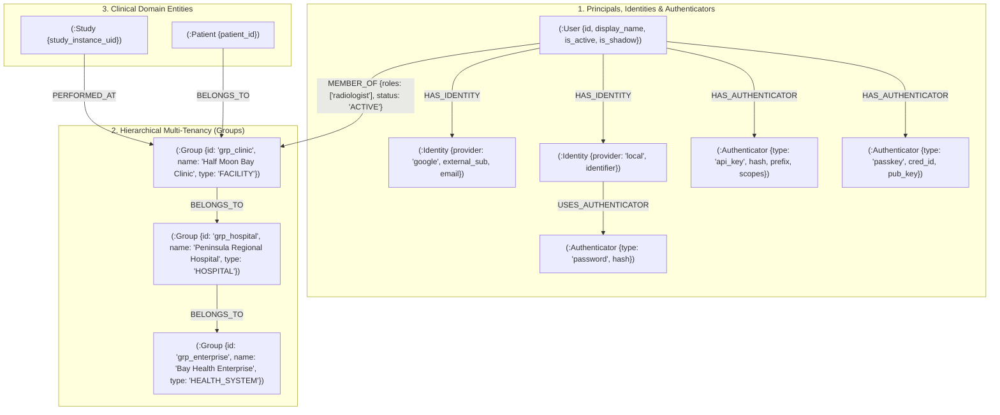
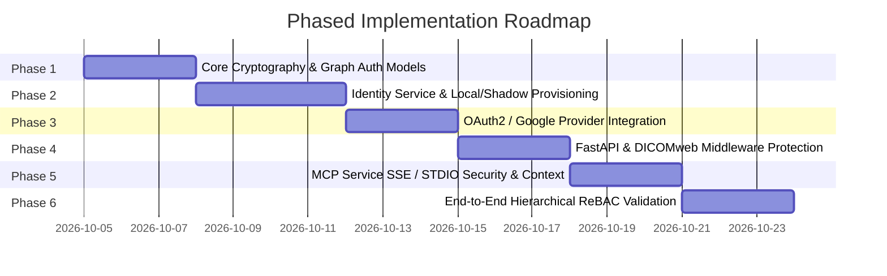

# Authentication, Authorization & Identity Security Design Specification

**Document ID:** SEC-GSGS-050  
**Project:** `gosmart-graphite`  
**Regulatory Alignment:** HIPAA Security Rule (§ 164.312), FDA Cybersecurity in Medical Devices (Section 524B FD&C Act), IEC 62304 Clause 5.3  
**Status:** Approved for Phased Implementation  

---

## 1. Executive Summary & Security Objectives

This specification defines the authentication (AuthN), authorization (AuthZ), and identity management architecture for the `gosmart-graphite`. The architecture secures both **FastAPI REST / DICOMweb endpoints** and the **Model Context Protocol (MCP) service** ([`service/mcp_service.py`](file://src/gosmart_graphite/service/mcp_service.py)).

### Core Objectives:
1. **Decoupled Identity & Authenticator Model**: Clear separation between `User` (principal), `Identity` (provider linkage), and `Authenticator` (credentials/factors).
2. **Hybrid Account Types**: Native support for **Local Accounts** and **Shadow Accounts** (Federated OAuth2/OIDC, Google Login) with Just-In-Time (JIT) provisioning.
3. **Multi-Group & Hierarchical ReBAC**: Relationship-Based Access Control enforcing top-down visibility (e.g., Enterprise Admins) down to scoped leaf clinic access (e.g., remote facility nurses) using native Neo4j graph traversals.
4. **End-to-End Endpoint Protection**: Unified JWT-based access control across HTTP REST, DICOMweb (`/qido-rs`, `/wado-rs`, `/stow-rs`), and MCP transports (SSE and STDIO).
5. **Auditability & Provenance**: Enforcing cryptographic identity binding to graph-level `ActedBy` and `ActedInGroup` metadata for HIPAA compliance.

---

## 2. Graph Identity & Access Control Architecture


---

## 3. Schema Definitions

### 3.1 Node Labels & Attributes

#### `(:User)`
* `id` *(str, UUIDv5)*: Deterministic principal ID.
* `display_name` *(str)*: User's full or preferred name.
* `primary_email` *(str)*: Verified primary email address.
* `is_active` *(bool)*: Global account active status.
* `is_shadow` *(bool)*: `True` if JIT-provisioned via OAuth without local password.
* `system_roles` *(List[str])*: Global platform roles (e.g. `["PLATFORM_ADMIN"]` or `["USER"]`).

#### `(:Identity)`
* `id` *(str, UUIDv5)*: Deterministic identity ID (`generate_deterministic_id({"provider": p, "sub": s})`).
* `provider` *(str)*: `google` | `local` | `github` | `saml_sso`.
* `external_sub` *(str)*: Unique provider subject identifier (e.g., Google `sub`).
* `identifier` *(str)*: Canonical login username or email.
* `email` *(str)*: Provider reported email.
* `email_verified` *(bool)*: Whether IdP reported verified email.
* `profile_metadata` *(str, JSON)*: Extra IdP claims (avatar, locale, etc.).

#### `(:Authenticator)`
* `id` *(str, UUIDv5)*: Deterministic authenticator ID.
* `type` *(str)*: `password` | `api_key` | `passkey` | `totp`.
* `secret_hash` *(str)*: Argon2id hash for passwords, SHA-256 hash for API keys.
* `prefix` *(Optional[str])*: Key prefix for API keys (`gs_live_...`).
* `scopes` *(List[str])*: Allowed scopes for API keys (e.g. `["mcp:full", "dicom:read"]`).
* `expires_at` *(Optional[datetime])*: Credential expiration.
* `last_used_at` *(Optional[datetime])*: Timestamp of last successful verification.

#### `(:Group)`
* `id` *(str, UUIDv5)*: Deterministic group ID.
* `name` *(str)*: Human readable facility or organizational group name.
* `code` *(str)*: Alphanumeric unique code (e.g. `HMB_IMG_01`).
* `group_type` *(str)*: `HEALTH_SYSTEM` | `HOSPITAL` | `FACILITY` | `DEPARTMENT` | `CARE_TEAM`.
* `is_active` *(bool)*: Active status flag.

### 3.2 Relationships
* `(:User)-[:HAS_IDENTITY]->(:Identity)`
* `(:Identity)-[:USES_AUTHENTICATOR]->(:Authenticator)`
* `(:User)-[:HAS_AUTHENTICATOR]->(:Authenticator)` *(direct MFA, WebAuthn, or API keys)*
* `(:User)-[:MEMBER_OF {roles: List[str], permissions: List[str], status: str}]->(:Group)`
* `(:Group)-[:BELONGS_TO]->(:Group)` *(and root catch-all `(:Group {name: 'GoSmart Health'})-[:BELONGS_TO]->(:System)`)*
* `(:Study)-[:PERFORMED_AT]->(:Group)`
* `(:Patient)-[:BELONGS_TO]->(:Group)`
* `(:Encounter)-[:BELONGS_TO]->(:Group)` *(created by `FhirActor` during FHIR ingestion when `group_id` resolves to an active, non-deleted `Group`; empty, missing, or soft-deleted/inactive groups log an error while continuing ingestion)*
* `(:DICOMConfiguration)-[:SCOPED_TO]->(:Group)`
* `(:Group)-[:HAS_LLM_CONFIG]->(:LLM_Config)` *(upward traversal via `BELONGS_TO*0..` over `:Group` nodes resolves active group LLM settings with `'GoSmart Health'` fallback; negated as `NOT_HAS_LLM_CONFIG`)*

---

## 4. Hierarchical Visibility & ReBAC Traversal Logic

### 4.1 Downward Visibility Rule
Access scope is dynamically computed per user query using the downward transitive closure of the organizational tree:

```cypher
// 1. Resolve effective group scope for a user
MATCH (u:User {id: $user_id})-[:MEMBER_OF {status: 'ACTIVE'}]->(user_grp:Group)
OPTIONAL MATCH (sub_grp:Group)-[:BELONGS_TO*1..]->(user_grp)
WITH collect(DISTINCT user_grp) + collect(DISTINCT sub_grp) AS accessible_groups

// 2. Filter target DICOM entities
MATCH (p:Patient)-[:HAS_STUDY]->(s:Study)-[:PERFORMED_AT]->(g:Group)
WHERE g IN accessible_groups
RETURN p, s
```

### 4.2 Top-Level Admin vs. Leaf Nurse Scenarios
1. **Top-Level Admin (Bay Health Enterprise)**:
   * Direct affiliation at `Bay Health Enterprise`.
   * Traversal traverses all child hospitals (*Peninsula Regional*) and leaf clinics (*Half Moon Bay Clinic*).
   * Result: **Enterprise-wide visibility** over all studies, patients, subordinate users, and audit logs.
2. **Remote Nurse (Half Moon Bay Clinic)**:
   * Direct affiliation at `Half Moon Bay Clinic`.
   * Traversal terminates at the leaf level (no downward children).
   * Result: **Strict localized visibility** restricted to studies performed at or patients belonging to *Half Moon Bay Clinic*.

---

## 5. Phased Implementation Roadmap & Validation



### Phase 1: Core Cryptography & Graph Models
* **Scope**:
  1. Add dependencies: `pyjwt>=2.8.0`, `passlib[argon2]>=1.7.4`, `cryptography>=42.0.0`.
  2. Implement `core/security.py`: Argon2 password hashing, API key hashing (`SHA-256`), JWT signing and decoding (RS256/HS256).
  3. Define graph models in `model/auth.py`: `UserNode`, `IdentityNode`, `AuthenticatorNode`, `GroupNode`, `MemberOfRelation`, `BelongsToRelation`.
* **Validation**:
  * Unit tests verifying Argon2 password hashing/verification.
  * Deterministic ID generation tests for `UserNode` and `IdentityNode`.
  * Unit tests verifying JWT token generation, expiration enforcement, and signature verification.

### Phase 2: User, Identity & Group Services
* **Scope**:
  1. Implement `service/user_service.py` with Neo4j transactions:
     - `create_local_user(username, email, password, roles, group_affiliations)`
     - `find_or_create_shadow_user(provider, sub, email, display_name, default_group_id)`
     - `authenticate_local(identifier, password) -> User`
     - `authenticate_api_key(raw_key) -> User`
  2. Implement `service/group_service.py`:
     - Group hierarchy CRUD (`create_group`, `nest_group`, `add_member`).
     - `get_effective_accessible_groups(user_id) -> List[str]`.
* **Validation**:
  * Integration tests with Neo4j test fixtures (`test_id` isolation).
  * Verify shadow user auto-creation on first simulated login.
  * Verify account promotion (attaching a local password authenticator to a shadow user).
  * Test transitive group resolution: Enterprise admin gets all child groups; facility user gets only child/self groups.

### Phase 3: OAuth2 & Google Authentication
* **Scope**:
  1. Implement `api/v1/endpoints/auth.py`:
     - `POST /api/v1/auth/login` (Local credentials $\rightarrow$ Access JWT + Refresh Token).
     - `POST /api/v1/auth/oauth/google` (Google ID token / auth code $\rightarrow$ Shadow user JIT provisioning $\rightarrow$ JWT).
     - `POST /api/v1/auth/refresh` (Refresh token rotation).
     - `POST /api/v1/auth/api-keys` (Generate scoped API keys for CLI & MCP agents).
* **Validation**:
  * Mock Google OIDC token verification tests.
  * Token refresh flow verification (expired access token refreshed via valid refresh token).
  * Rejection of revoked or tampered refresh tokens.

### Phase 4: Securing REST & DICOMweb Endpoints
* **Scope**:
  1. Implement `core/auth_dependency.py`:
     - `get_current_user` (Extract & decode Bearer JWT or API key).
     - `get_current_group_context` (Validate optional `X-Group-ID` against user's accessible groups).
     - `require_roles(roles: List[str])`.
  2. Guard [`api/v1/router.py`](file://src/gosmart_graphite/api/v1/router.py) and DICOMweb endpoints (`/dicomweb/*`).
  3. Bind authenticated user context into structured logging (`main.py` middleware) and graph mutation metadata (`ActedBy`, `ActedInGroup`).
* **Validation**:
  * HTTP 401 Unauthorized tests for unauthenticated requests on protected endpoints.
  * HTTP 403 Forbidden tests when user lacks role or access to requested group.
  * Verification that QIDO-RS `/studies` only returns studies within the user's effective group scope.

### Phase 5: Securing MCP Service (`service/mcp_service.py`)
* **Scope**:
  1. Wrap MCP Starlette SSE app (`mcp.sse_app()`) with authentication middleware:
     - Validate Bearer token on `/sse` stream handshake and `/messages` HTTP POST.
     - Allow token via query parameter (`?token=...`) for browser EventSource compatibility.
  2. Implement STDIO security:
     - Validate CLI environment token `GOSMART_MCP_API_KEY` or default to verified local system operator.
  3. Propagate caller identity:
     - Dynamically populate `acted_by = f"user:{current_user.email}"` and `acted_in_group = active_group_id` into all MCP tools.
  4. Tool-level RBAC: Guard destructive MCP tools (e.g. system config update, delete operations).
* **Validation**:
  * Integration tests connecting to `/mcp/sse` with valid and invalid JWTs.
  * Verify that MCP tool executions record the caller's identity in Neo4j graph audit trails.
  * Verify that an MCP agent scoped to a remote clinic cannot query studies from a sibling clinic.

### Phase 6: End-to-End Security & Compliance Verification
* **Scope**:
  1. Multi-tenant boundary penetration test (simulated cross-tenant data access attempts).
  2. Test suite cleanup and idempotency verification using `test_id` properties.
  3. Run full Ruff lint, format, and type checks (`uv run ruff check .` and `uv run ruff format --check .`).
* **Validation**:
  * 100% automated test pass rate for all authentication, authorization, and group traversal test suites.
  * Zero security regressions in DIMSE SCP, DICOMweb, and MCP functionality.

---

## 6. Document History

| Version | Date | Author | Description of Changes |
| :--- | :--- | :--- | :--- |
| **1.0.0** | 2026-10-04 | Core Architecture Team | Initial design specification covering JWT, OAuth2, Shadow Accounts, Groups, and MCP protection. |
| **1.1.0** | 2026-11-15 | Core Architecture Team | Added `(:Group)-[:HAS_LLM_CONFIG]->(:LLM_Config)` group-scoped LLM configuration relationship and MCP `X-Group-ID` active group propagation. |
