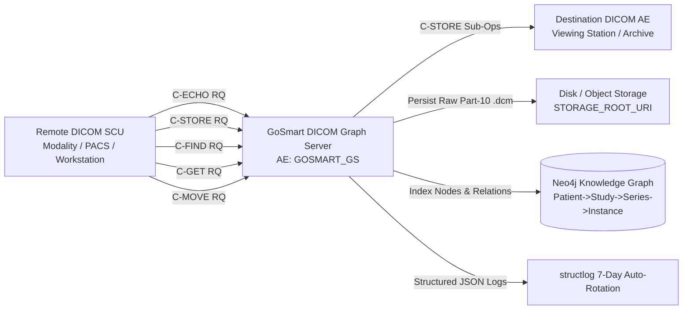

# DICOM Conformance Statement

**Document Title:** DICOM Conformance Statement for GoSmart.Health DICOM Graph Server & VNA  
**Software Name:** `gosmart-dicom-py-graph-server`  
**Software Release:** Version 0.1.0  
**Document Release Date:** 2026-09-25  
**Standard Compliance:** NEMA PS 3.1 – PS 3.22 (DICOM Standard 2024c / 2025)  
**Document Identifier:** DCS-GSGS-001  

---

> [!IMPORTANT]
> **Product Classification & Intended Use**
> 
> The GoSmart DICOM Graph Server (`gosmart-dicom-py-graph-server`) is a graph-native **Vendor Neutral Archive (VNA)** and medical imaging knowledge engine. It provides standard DICOM Upper Layer network communication (DIMSE), graph-topological persistence (Neo4j), Pykka actor-based asynchronous processing, and headless control via CLI and Model Context Protocol (MCP) tool interfaces.
> 
> It is intended to function as an enterprise medical image archive and research platform supporting **C-STORE**, **C-FIND**, **C-GET**, **C-MOVE**, and **C-ECHO** network transactions with zero dependency on client web UIs.

---

## 1. Conformance Statement Overview

The GoSmart DICOM Graph Server provides standard DICOM Part 10 file storage, hierarchical metadata indexing into a Neo4j property graph, and DICOM Upper Layer (DIMSE) network communication over TCP/IP as both a Service Class Provider (SCP) and Service Class User (SCU).

### 1.1 Network Services Supported

The following table summarizes the network services, roles, and SOP Classes supported by `gosmart-dicom-py-graph-server`:

| SOP Class Name | SOP Class UID | Service Class User (SCU) | Service Class Provider (SCP) |
| :--- | :--- | :---: | :---: |
| **Verification** | | | |
| Verification SOP Class | `1.2.840.10008.1.1` | **Yes** | **Yes** |
| **Query/Retrieve - FIND** | | | |
| Patient Root Query/Retrieve Information Model - FIND | `1.2.840.10008.5.1.4.1.2.1.1` | **Yes** | **Yes** |
| Study Root Query/Retrieve Information Model - FIND | `1.2.840.10008.5.1.4.1.2.2.1` | **Yes** | **Yes** |
| Modality Worklist Information Model - FIND | `1.2.840.10008.5.1.4.31` | **Yes** | **Yes** |
| **Query/Retrieve - GET** | | | |
| Patient Root Query/Retrieve Information Model - GET | `1.2.840.10008.5.1.4.1.2.1.3` | **Yes** | **Yes** |
| Study Root Query/Retrieve Information Model - GET | `1.2.840.10008.5.1.4.1.2.2.3` | **Yes** | **Yes** |
| **Query/Retrieve - MOVE** | | | |
| Patient Root Query/Retrieve Information Model - MOVE | `1.2.840.10008.5.1.4.1.2.1.2` | **Yes** | **Yes** |
| Study Root Query/Retrieve Information Model - MOVE | `1.2.840.10008.5.1.4.1.2.2.2` | **Yes** | **Yes** |
| **Storage (C-STORE & Retrieve Sub-Operations)** | | | |
| Computed Tomography (CT) Image Storage | `1.2.840.10008.5.1.4.1.1.2` | **Yes** | **Yes** |
| Enhanced CT Image Storage | `1.2.840.10008.5.1.4.1.1.2.1` | **Yes** | **Yes** |
| Magnetic Resonance (MR) Image Storage | `1.2.840.10008.5.1.4.1.1.4` | **Yes** | **Yes** |
| Enhanced MR Image Storage | `1.2.840.10008.5.1.4.1.1.4.1` | **Yes** | **Yes** |
| Secondary Capture Image Storage | `1.2.840.10008.5.1.4.1.1.7` | **Yes** | **Yes** |
| Multi-frame Grayscale Byte Secondary Capture Image Storage | `1.2.840.10008.5.1.4.1.1.7.2` | **Yes** | **Yes** |
| Multi-frame Grayscale Word Secondary Capture Image Storage | `1.2.840.10008.5.1.4.1.1.7.3` | **Yes** | **Yes** |
| Multi-frame True Color Secondary Capture Image Storage | `1.2.840.10008.5.1.4.1.1.7.4` | **Yes** | **Yes** |
| Digital X-Ray Image Storage - For Presentation | `1.2.840.10008.5.1.4.1.1.1.1` | **Yes** | **Yes** |
| Digital X-Ray Image Storage - For Processing | `1.2.840.10008.5.1.4.1.1.1.1.1` | **Yes** | **Yes** |
| Digital Mammography X-Ray Image Storage - For Presentation | `1.2.840.10008.5.1.4.1.1.1.2` | **Yes** | **Yes** |
| Digital Mammography X-Ray Image Storage - For Processing | `1.2.840.10008.5.1.4.1.1.1.2.1` | **Yes** | **Yes** |
| Ultrasound Image Storage | `1.2.840.10008.5.1.4.1.1.6.1` | **Yes** | **Yes** |
| Ultrasound Multi-frame Image Storage | `1.2.840.10008.5.1.4.1.1.3.1` | **Yes** | **Yes** |
| Nuclear Medicine Image Storage | `1.2.840.10008.5.1.4.1.1.20` | **Yes** | **Yes** |
| Positron Emission Tomography (PET) Image Storage | `1.2.840.10008.5.1.4.1.1.128` | **Yes** | **Yes** |
| X-Ray Angiographic Image Storage | `1.2.840.10008.5.1.4.1.1.12.1` | **Yes** | **Yes** |
| X-Ray Radiofluoroscopic Image Storage | `1.2.840.10008.5.1.4.1.1.12.2` | **Yes** | **Yes** |
| Radiation Therapy (RT) Structure Set Storage | `1.2.840.10008.5.1.4.1.1.481.3` | **Yes** | **Yes** |
| Radiation Therapy (RT) Dose Storage | `1.2.840.10008.5.1.4.1.1.481.2` | **Yes** | **Yes** |
| Radiation Therapy (RT) Plan Storage | `1.2.840.10008.5.1.4.1.1.481.5` | **Yes** | **Yes** |
| Grayscale Softcopy Presentation State Storage (GSPS) | `1.2.840.10008.5.1.4.1.1.11.1` | **Yes** | **Yes** |
| Comprehensive SR Storage | `1.2.840.10008.5.1.4.1.1.88.33` | **Yes** | **Yes** |
| All Standard Composite Storage SOP Classes | Any valid composite UID | **Yes** | **Yes** |

### 1.2 Supported Transfer Syntaxes

The server supports negotiation and transmission across all standard uncompressed and compressed transfer syntaxes:

| Transfer Syntax Name | Transfer Syntax UID | Supported Roles |
| :--- | :--- | :---: |
| **Explicit VR Little Endian** (Default Transfer Syntax) | `1.2.840.10008.1.2.1` | SCP / SCU |
| **Implicit VR Little Endian** (Default Fallback) | `1.2.840.10008.1.2` | SCP / SCU |
| **Deflated Explicit VR Little Endian** | `1.2.840.10008.1.2.1.99` | SCP / SCU |
| **JPEG Baseline (Process 1)** | `1.2.840.10008.1.2.4.50` | SCP / SCU |
| **JPEG 2000 Image Compression (Lossless Only)** | `1.2.840.10008.1.2.4.90` | SCP / SCU |
| **JPEG 2000 Image Compression** (Lossy) | `1.2.840.10008.1.2.4.91` | SCP / SCU |
| **RLE Lossless** | `1.2.840.10008.1.2.5` | SCP / SCU |

---

## 2. Networking & Application Data Flow

### 2.1 Application Data Flow Diagram

### 2.2 Functional Definition of Application Entities (AEs)

#### 2.2.1 `GOSMART_GS` Application Entity
The `GOSMART_GS` AE acts as a single multi-role Application Entity responsible for:
1. **Verification (C-ECHO)**: Accepting and responding to verification requests from remote modalities, archives, and monitoring agents.
2. **Storage (C-STORE SCP)**: Receiving incoming composite SOP Instances, persisting raw Part-10 files to `STORAGE_ROOT_URI`, extracting DICOM hierarchy tags, and notifying the `DicomIngestionActor` to index graph topology into Neo4j.
3. **Query (C-FIND SCP)**: Receiving query requests for Patient Root, Study Root, and Modality Worklist information models, executing high-speed Cypher queries in Neo4j, and returning matching dataset identifiers.
4. **Retrieve (C-GET SCP)**: Receiving retrieve requests and transmitting matching SOP instances back across the same association using C-STORE sub-operations.
5. **Move (C-MOVE SCP)**: Receiving retrieve requests for designated destination Application Entities, opening secondary C-STORE SCU associations, and streaming instances to the requested target.

### 2.3 Sequencing of Real-World Activities

1. **Storage Workflow**:
   - Remote SCU establishes association with `GOSMART_GS`.
   - SCU sends `C-STORE-RQ` with dataset.
   - `GOSMART_GS` verifies presentation context and receives byte stream.
   - Raw dataset is saved to `STORAGE_ROOT_URI/{sop_instance_uid}.dcm`.
   - `DicomIngestionActor` receives parsed metadata and merges `(:Patient)`, `(:Study)`, `(:Series)`, `(:Instance)` nodes in Neo4j with unique constraints.
   - `C-STORE-RSP` (Status `0x0000` Success) is returned to the SCU.
2. **Query Workflow**:
   - Remote SCU sends `C-FIND-RQ` (e.g., Study Root level for PatientID or StudyDate).
   - `GOSMART_GS` maps query keys to Cypher query parameters and executes index lookup on Neo4j.
   - For each matching study/series/instance, a `C-FIND-RSP` with status `0xFF00` (Pending) is returned.
   - A final `C-FIND-RSP` with status `0x0000` (Success) completes the transaction.
3. **Retrieve (Move/Get) Workflow**:
   - Remote SCU sends `C-MOVE-RQ` or `C-GET-RQ` specifying StudyInstanceUID or SOPInstanceUID.
   - `GOSMART_GS` queries Neo4j for storage URIs of matching instances.
   - For C-MOVE: `GOSMART_GS` opens secondary association with destination AE Title and issues `C-STORE-RQ` sub-operations.
   - For C-GET: `GOSMART_GS` streams instances directly over the established association.
   - Progress responses (`0xFF00`) indicate remaining and completed sub-operations, followed by status `0x0000`.

---

## 3. AE Specifications

### 3.1 `GOSMART_GS` AE Specification

#### 3.1.1 Association Policies
- **General**: The default maximum PDU size is `16,382` bytes (configurable via `GOSMART_GS_DICOM_MAX_PDU` up to `65,536` bytes).
- **Number of Associations**: Supports up to 20 concurrent inbound associations.
- **Asynchronous Nature**: Does not support asynchronous window negotiation (single outstanding transaction per association).

#### 3.1.2 Association Initiation Policy
`GOSMART_GS` initiates associations under the following real-world conditions:
- Executing C-ECHO verification SCU (via CLI `gosmart-gs echo` or MCP tool `echo_scu`).
- Executing C-MOVE retrieve sub-operations to transmit requested DICOM objects to designated remote AE Titles.

#### 3.1.3 Association Acceptance Policy
`GOSMART_GS` accepts associations from any calling AE Title by default (promiscuous acceptance mode for local network testing and integration), or rejects unknown calling AE Titles if strict verification mode is enabled.

### 3.2 SOP Specific Conformance for Query/Retrieve Services

#### 3.2.1 C-FIND SCP Attributes Supported
The following attributes are indexed in the Neo4j Knowledge Graph and supported for matching and return in C-FIND operations:

| Tag | Attribute Name | Matching Supported | Return Supported |
| :--- | :--- | :---: | :---: |
| `(0010,0010)` | Patient's Name | Single Value, Wildcard (`*`, `?`) | Yes |
| `(0010,0020)` | Patient ID | Single Value, List of UIDs | Yes |
| `(0010,0030)` | Patient's Birth Date | Single Value, Range (`-`) | Yes |
| `(0010,0040)` | Patient's Sex | Single Value | Yes |
| `(0020,000D)` | Study Instance UID | Single Value, List of UIDs | Yes |
| `(0008,0020)` | Study Date | Single Value, Range (`-`) | Yes |
| `(0008,0030)` | Study Time | Single Value, Range (`-`) | Yes |
| `(0008,0050)` | Accession Number | Single Value, Wildcard | Yes |
| `(0008,1030)` | Study Description | Single Value, Wildcard | Yes |
| `(0008,0060)` | Modality | Single Value | Yes |
| `(0020,000E)` | Series Instance UID | Single Value, List of UIDs | Yes |
| `(0020,0011)` | Series Number | Single Value | Yes |
| `(0008,103E)` | Series Description | Single Value, Wildcard | Yes |
| `(0008,0018)` | SOP Instance UID | Single Value, List of UIDs | Yes |
| `(0020,0013)` | Instance Number | Single Value | Yes |

---

## 4. Communication Profiles

- **TCP/IP Stack**: Native Python standard library socket stack with `pynetdicom` 3.0.4 Upper Layer protocol framing over IPv4 and IPv6.
- **Physical Media**: IEEE 802.3 (Ethernet) 10/100/1000/10000 Mbps.
- **Security & TLS Profiles**: Supports TLS 1.3 encryption for DICOM Upper Layer associations in healthcare enterprise configurations.

---

## 5. Configuration

Configured through environment variables (`GOSMART_GS_*`) or `.env`:

| Parameter | Default Value | Configurable | Description |
| :--- | :--- | :---: | :--- |
| `GOSMART_GS_DICOM_AE_TITLE` | `GOSMART_GS` | Yes | Local DICOM Application Entity Title |
| `GOSMART_GS_DICOM_SCP_PORT` | `11112` | Yes | DICOM Upper Layer TCP Listener Port |
| `GOSMART_GS_DICOM_MAX_PDU` | `16382` | Yes | Maximum PDU Receive Packet Size (bytes) |
| `GOSMART_GS_STORAGE_ROOT_URI` | `file:///tmp/gosmart_dicom_storage` | Yes | Binary Part-10 file storage location |
| `GOSMART_GS_DB_CONNECTION_URI` | `bolt://localhost:7687` | Yes | Neo4j Knowledge Graph bolt URI |
| `GOSMART_GS_LOG_ROTATION_DAYS` | `7` | Yes | Audit and system log auto-rotation schedule |
