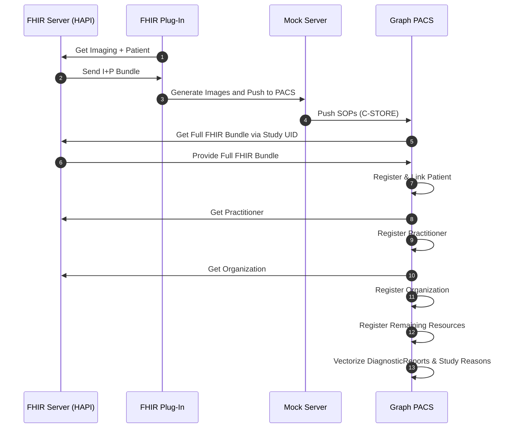

# FHIR Configuration

The `FHIRConfiguration` node describes an upstream FHIR server that GRAPHITE
polls for resources (via the background `FhirActor`) to synchronize clinical
data with the knowledge graph.

## Registering a configuration

From a JSON file via the CLI:

```bash
uv run gosmart-graphite configure fhir-config --file devop-scripts/fhir_config.template.json
uv run gosmart-graphite configure fhir-config --file /path/to/my_fhir_config.json --assign <group_id>
```

## Template reference

The sanitized starter template (`devop-scripts/fhir_config.template.json`):

```json
{
  "url": "http://localhost:8080/fhir",
  "accession_system": "http://hospital.example.org/accession",
  "patient_id_system": "urn:oid:2.16.840.1.113883.4.3.25",
  "poll_sec": 120
}
```

| Field | Meaning |
|:------|:--------|
| `url` | Root URL of the FHIR server (for example a HAPI FHIR deployment). |
| `accession_system` | Identifier system URI used for Accession Number matching. |
| `patient_id_system` | Identifier system URI used for Patient ID / MRN matching (the default is the SSN OID `urn:oid:2.16.840.1.113883.4.3.25`). |
| `poll_sec` | Polling interval in seconds. |

## Related environment variables

Process-level FHIR defaults can also be set with `GOSMART_GS_FHIR_BASE_URL`,
`GOSMART_GS_FHIR_POLL_SEC`, `GOSMART_GS_FHIR_ACCESSION_SYSTEM`, and
`GOSMART_GS_FHIR_PATIENT_ID_SYSTEM` — see
[Environment Variables](environment-variables.md#fhir).

## FHIR Process Sequence

This sequence illustrates how the **FHIR Plug-In** interacts with HAPI FHIR and
the GoSmart Mock Server to generate DICOM images, push them to Graph PACS, and
trigger FHIR resource synchronization and vectorization. *(Synchronous return
arrows for standard `GET` requests are omitted for brevity.)*



## Related tooling

- The GoSmart **FHIR Plug-In** (PRO subscription) bridges GRAPHITE and
  commercial/open FHIR servers for EHR integration testing, and can connect
  directly to commercial EHRs such as **Epic** and **Redox** via JWKS and
  OAuth2 over encrypted channels. See [Testing & Ecosystem](../getting-started/testing-ecosystem.md).
- The FHIR graph side of the model is summarized in the
  [Cypher Query Guide](../getting-started/cypher-query-guide.md).
