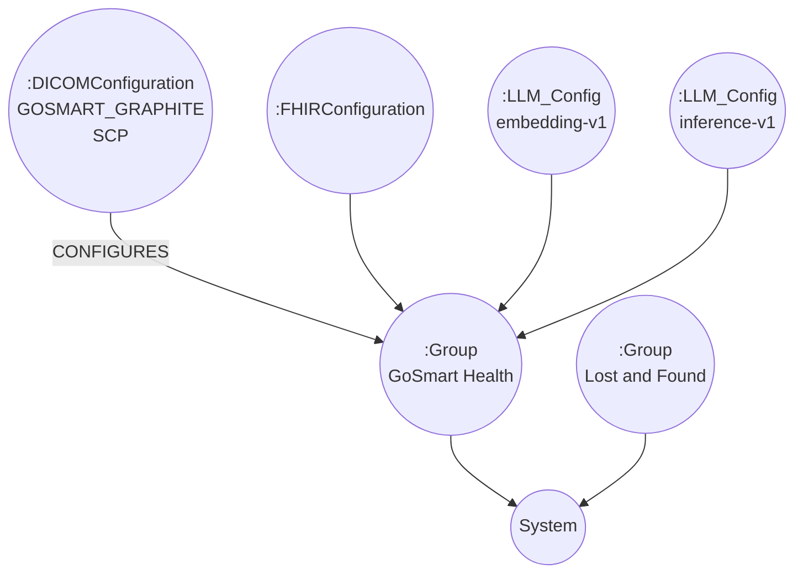

# Configuration Overview

GRAPHITE configuration lives in **two layers**:

1. **Process-level settings** — `GOSMART_GS_*` environment variables (and
   `.env`) loaded at boot via Pydantic Settings. These cover the database
   connection, HTTP server, logging, storage, and authentication.
   See [Environment Variables](environment-variables.md).

2. **Graph-resident configurations** — `DICOMConfiguration`,
   `FHIRConfiguration`, and `LLM_Config` **nodes stored in Neo4j** and attached
   to sponsoring `(:Group)` nodes via `[:HAS_*]` relationships. These can be
   created, updated, soft-deleted, and restored at runtime — over the REST
   API, the CLI, or [MCP tools](../mcp/tools.md) — without restarting the
   server.

## Why configurations live in the graph

The root `(:System)` node is created (idempotently) on first boot, beneath
which top-level `Group` nodes are attached. By default the system creates the
`GoSmart Health` and `Lost and Found` groups.

New top-level provider organizations attach under `System`, while departmental
sub-groups (such as `Radiology`) attach beneath their parent organization
group. Groups hold references to scoped configurations, so separate
organizations can use distinct credentials, endpoints, and billing accounts
even when sharing the same underlying models.

## Registering configurations

| Channel | Command / endpoint |
|:--------|:-------------------|
| **CLI** | `uv run gosmart-graphite configure dicom-config --file <json>` `uv run gosmart-graphite configure fhir-config --file <json>` `uv run gosmart-graphite configure llm-config --file <json> [--assign "<group>"]` |
| **REST** | `POST /api/v1/configurations/dicom`, `POST /api/v1/configurations/llm`, FHIR settings via env/FHIR config nodes |
| **MCP** | `create_dicom_configuration`, `upsert_llm_configuration`, and friends — see the [Tool Catalog](../mcp/tools.md) |

Per-page details:

- [Environment Variables](environment-variables.md)
- [Bootstrapping & Administration](administration.md)
- [DICOM Configurations](dicom-configurations.md)
- [DICOM Conformance Statement](dicom-conformance-statement.md)
- [FHIR Configuration](fhir-configuration.md)
- [LLM Configurations](llm-configurations.md)

### REST API authentication

Protected configuration and system endpoints accept either:

- **API Key** — `X-API-Key: gs_live_...` or `Authorization: Bearer gs_live_...`
- **JWT Access Token** — `Authorization: Bearer <access_token>` obtained via
  `POST /api/v1/auth/login` or `/api/v1/auth/oauth/google`

See [Bootstrapping & Administration](administration.md#3-out-of-band-api-key-generation)
to create API keys from the CLI.

## Immutability & soft deletion (`NOT_` semantics)

Nodes are treated as immutable once created; updates and deletions are
implemented non-destructively. A soft deletion clones the existing node or
relationship and swaps the relationship type to `NOT_<rel_type>` (for example
`:HAS_STUDY` becomes `:NOT_HAS_STUDY`) inside an atomic write transaction.

Consequently:

- Deleted nodes and relationships remain in the graph, preserving the full
  history of deletions and updates.
- Every deleted relationship can be restored atomically
  (`restore` endpoints / `restore_*` MCP tools).
- Audit metadata (`Action`, `ActedBy`, `ActedAt`, `CreatedAt`) is stamped on
  every mutation.

See the [Cypher Query Guide](../getting-started/cypher-query-guide.md) for
querying conventions and `NOT_` relationship behavior in Neo4j.
