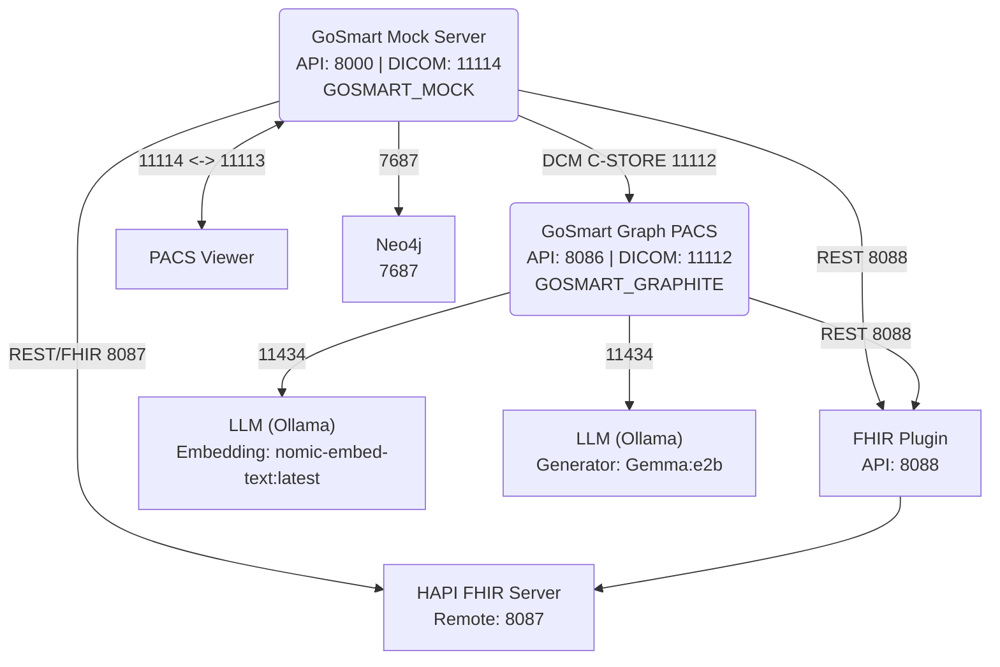

# Testing & Ecosystem

This guide describes the **GoSmart Testing Ecosystem** for end-to-end local
validation, along with the automated test suites, linting gates, DevOps
utilities, and interactive Jupyter notebooks included in the repository.

## GoSmart Testing Ecosystem

You can combine GRAPHITE with a local multi-service suite to validate DICOM
networking, FHIR synchronization, and GraphRAG workflows end to end:

- **GoSmart Mock Server** — Generates synthetic DICOM instances (Docker images
  available).
- **FHIR Plug-In (PRO Subscription)** — Bridges GRAPHITE and commercial/open
  FHIR servers to test EHR integration and GraphRAG capabilities. PRO
  subscribers have access to combined Mock Server + FHIR Plug-In Docker Compose
  environments.
- **HAPI FHIR Server** — Dockerized local FHIR R4 server.
- **Synthea™** — Generates synthetic patients and clinical studies for loading
  into HAPI FHIR.
- **PACS Viewer** — On Windows, we recommend MicroDICOM viewer with DICOM Q/R
  and `C-MOVE`.
- **Neo4j** — Graph database backend. Works with Neo4j Aura Free or a local
  Neo4j Community Docker container.
- **LLM Server** — Host open-weight models locally via Ollama (selected
  embedding/generation models run within 6 GB of GPU memory) or connect to
  Google Vertex AI / Gemini via Genkit.

For more information on GoSmart tools, visit the
[GoSmart Health Products Page](https://gosmart.health/products/).



For the step-by-step FHIR ingestion and vectorization flow across these
services, see [FHIR Configuration — Process Sequence](../configuration/fhir-configuration.md#fhir-process-sequence).

## Running Automated Tests

GRAPHITE organizes its `pytest` suite into three tiers:

```bash
# 1. Self-contained unit tests (used by CI — no Neo4j or external services required)
uv run pytest tests/unit --verbose

# 2. Integration tests (requires a running Neo4j instance)
uv run pytest tests/integration --verbose

# 3. Live end-to-end tests (external FHIR proxy, MicroDICOM, MCP, or Gemini API;
#    unavailable services are skipped where supported)
uv run pytest tests/live --verbose

# Run all test suites locally
uv run pytest
```

!!! note "Test Data Isolation (`test_id`)"
    Integration tests stamp created Neo4j records with a `test_id` property so
    they never collide with production records. Test data is cleared **before**
    a run (not after) so you can inspect post-run graph state manually, or
    purge test records on demand via `POST /api/v1/system/test/cleanup`.

## Code Quality & Linting Gates

Before committing changes, verify Ruff lint and formatting checks pass:

```bash
uv run ruff check .
uv run ruff format --check .
```

## DevOps Utilities (`devop-scripts/`)

Helper scripts for configuration scaffolding (`scaffold_configs.sh`), pre/post-test
data cleanup (`cleanup-data.py`), Clinical NLU model training (`nlu-train.sh`),
and GitHub Actions secret syncing live under `devop-scripts/`. See
[`devop-scripts/README.md`](https://github.com/gosmart-health/gosmart-graphite/blob/main/devop-scripts/README.md)
for usage details.

## Interactive Jupyter Notebooks

Open `notebooks/exploration.ipynb` in your editor or launch Jupyter Lab:

```bash
uv run jupyter lab notebooks/
```

`exploration.ipynb` walks through:

1. Environment and dependency verification
2. Configuration loading with the `GOSMART_GS_*` prefix
3. In-memory DICOM generation and parsing with `pydicom` into Pydantic models
4. Background actor dispatch with `pykka` (`tell` and `ask`)
5. Graph queries and connectivity with `neo4j`
6. DICOM Application Entity (AE) setup and `C-ECHO` SCU ping with `pynetdicom`
