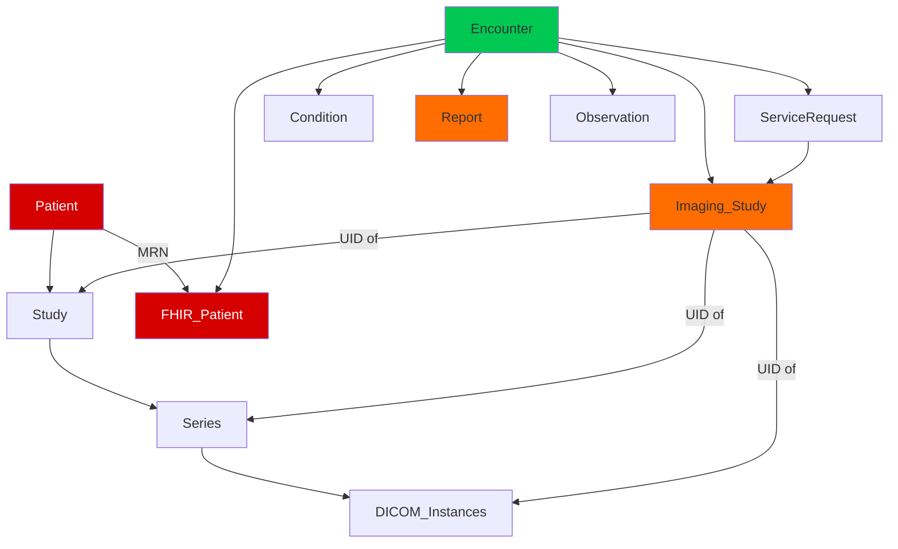

# Gosmart.Health GRAPHITE

**GRAPHITE** (`gosmart-graphite`) is a high-performance, graph-based clinical
DICOM and FHIR integrated server. It models imaging and clinical data as a
unified knowledge graph, serves it over REST and DICOMweb, and exposes it to
AI agents through the [Model Context Protocol (MCP)](mcp/index.md).

It is powered by **Python 3.14**, **FastAPI**, **Pydantic**, **Neo4j**,
**pydicom**, **pynetdicom**, and **Pykka**.

## What can it do?

- **Unified knowledge graph** — Models the DICOM hierarchy
  `(:Patient)-[:HAS_STUDY]->(:Study)-[:HAS_SERIES]->(:Series)-[:HAS_INSTANCE]`
  alongside FHIR R4B resources with uniqueness constraints and indexed lookups.
- **REST API with OpenAPI docs** — Async FastAPI endpoints with automated
  schemas served at `/docs` (Swagger UI) and `/redoc` (ReDoc).
- **DICOM network services** — C-ECHO SCU, C-STORE SCP/SCU, Verification, and
  a runtime-configurable SCP lifecycle with presentation-context enforcement.
- **DICOMweb** — Standard RESTful services: `STOW-RS`, `WADO-RS`, `QIDO-RS`.
- **Actor-based concurrency** — Pykka actors (`DicomIngestionActor`,
  `FhirActor`, `AuditActor`, `StoreSCUActor`) keep ingestion, FHIR
  synchronization, audit writes, and outbound transfers non-blocking.
- **Authentication & authorization** — JWT access/refresh tokens, API keys
  (`gs_live_` prefix), Google OAuth2/OIDC federated login, and scoped RBAC.
- **Storage-agnostic media service** — Local disk, S3, GCS, Azure Blob, and
  Windows UNC shares behind one async `fsspec`-based interface.
- **Vector embeddings & GraphRAG** — Group-scoped `LLM_Config` nodes resolved
  from Neo4j feed a Genkit-powered embedding service (Ollama, Vertex AI/Gemini).
- **Auditable & immutable entities** — Deterministic UUIDv5 IDs, UTC audit
  timestamps, immutable action metadata, and non-destructive soft deletion via
  `NOT_` relationship swaps.
- **Built-in MCP server** — StreamableHTTP, SSE, and STDIO transports for AI
  agents such as Cursor, Cline, and AntiGravity.
- **CLI management** — Typer-based `gosmart-graphite` / `gosmart-gs` command
  line for serving, ingestion, querying, and configuration.

## How the data fits together

DICOM studies are indexed into the graph and cross-linked with FHIR resources
through MRN and accession identifiers:

Configurations (DICOM, FHIR, LLM) are themselves graph nodes attached to
sponsoring `(:Group)` nodes beneath the root `(:System)` node, so separate
organizations can use distinct credentials and endpoints on shared hardware.
See [Configuration](configuration/index.md).

## Where to go next

- :material-rocket-launch: **[Getting Started](getting-started/index.md)**

  Install, configure, and boot the server — with Docker or `uv`.

- :material-tune: **[Configuration](configuration/index.md)**

  Environment variables and graph-resident DICOM, FHIR, and LLM settings.

- :material-robot: **[MCP for AI Agents](mcp/index.md)**

  Connect Cursor, Cline, or AntiGravity and drive the server by utterance.

